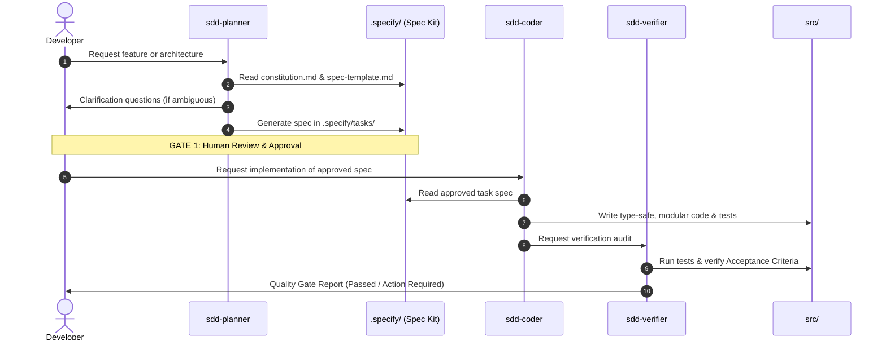

# SPEC-001: Nexus Kit Core Architecture & Orchestration Engine 🌌

> **Status:** `Completed`  
> **Author:** Senior AI Engineer (via `sdd-planner` skill)  
> **Date:** 2026-11-10  
> **Scope:** Core Framework, Integration Harness, Skills & Tooling
> **Approved-By:** `Tran Huu Quyet`  
> **Approved-At:** `2026-11-10T07:08:33.009Z`  
> **Approved-Hash:** `sha256:94c35f80571a5187d59fad6a22ba1bb3bceabe5ccf93e4f6d572d2e000daf0e3`  

---

## 1. Overview & Objective

### 1.1 Problem Statement
AI coding assistants fall into "Vibe Coding" when lacking explicit boundaries, leading to hallucinated dependencies, broken interfaces, and unmaintainable codebases. 
While **Spec Kit** provides strict specification governance and **Agent Skills** provides standardized agent execution protocols, there is no standardized bridge that connects them into a seamless, deterministic development lifecycle.

### 1.2 Objective
Establish **Nexus Kit** as the premier, zero-friction integration layer between **Spec Kit** and **Agent Skills**, ensuring that:
1. Every feature or architectural change must have an approved specification in `.specify/tasks/` before code can be written.
2. AI agents natively discover and execute standardized skills (`sdd-planner`, `sdd-coder`, `sdd-verifier`).
3. Specifications, constitutions, and agent skill configurations remain 100% interoperable with upstream Spec Kit and Agent Skills repositories.

### 1.3 Scope Boundaries
- **In-Scope:**
  - Standardized Spec Kit adapter templates in `.specify/templates/`.
  - Upgraded, bidirectional Agent Skills in `.agents/skills/` (`sdd-planner`, `sdd-coder`, `sdd-verifier`).
  - Traceability matrix linking tasks in `.specify/tasks/` directly to implementations in `src/`.
  - Automation scripts for validating spec-code parity (verification gate).
  - Synchronizing the generated boilerplate in `create-nexus-kit` with the core framework.
- **Out-of-Scope:**
  - Re-implementing external Git hosting or custom LLM runtime engines.
  - Modifying third-party Agent Skills outside the SDD domain.

---

## 2. Architecture & Data Contracts

### 2.1 File & Directory Map
```text
nexus-kit/
├── .specify/                         # Spec Kit Domain
│   ├── constitution.md               # Supreme project guidelines & tech stack
│   ├── templates/                    # Reusable spec templates (Spec Kit format)
│   │   └── spec-template.md
│   └── tasks/                        # Active & archived task specifications
│       └── 001-nexus-kit-integration-spec.md
├── .agents/                          # Agent Skills Domain
│   └── skills/
│       ├── sdd-planner/SKILL.md      # Skill: Elicit requirements -> generate spec
│       ├── sdd-coder/SKILL.md        # Skill: Read spec -> write deterministic code
│       └── sdd-verifier/SKILL.md     # Skill: Audit code vs spec acceptance criteria
├── src/                              # Implementation Domain
└── create-nexus-kit/                 # Scaffolding CLI Distribution
```

### 2.2 Spec Metadata Schema (Frontmatter)
Every specification created in `.specify/tasks/` must adhere to this YAML schema:
```yaml
id: SPEC-XXX
title: string
status: "Draft" | "In Review" | "Approved" | "In Progress" | "Completed"
author: string
created_at: YYYY-MM-DD
upstream_speckit_version: ">=1.0.0"
agent_skills_standard: "v1"
```

---

## 3. Workflow & Logic Flow



---

## 4. Acceptance Criteria (Tiêu chí nghiệm thu)

- [x] **AC-1 (Spec Template Standard)**: `.specify/templates/spec-template.md` exists and defines User Stories, Scope Boundaries, Data Models, Logic Flows, Error Scenarios, and Acceptance Criteria.
- [x] **AC-2 (Skills Triad)**:
  - `sdd-planner`: Guides AI to check constitution, interview user, and output standardized spec.
  - `sdd-coder`: Guides AI to implement code strictly according to spec, rejecting scope creep.
  - `sdd-verifier`: Performs audit of code against spec criteria before merge.
- [x] **AC-3 (Constitution Integration)**: `.specify/constitution.md` defines clear tech stack guardrails, zero vibe coding rule, and test mandate.
- [x] **AC-4 (Boilerplate Parity)**: The `create-nexus-kit` CLI package generates identical, fully functional templates matching the core repository.
- [x] **AC-5 (Zero Hallucination Guarantee)**: No code is written in `src/` without explicit mapping to an AC in this specification.

---

## 5. Implementation Roadmap (Thứ tự triển khai)

1. **Step 1**: Finalize `.specify/templates/spec-template.md` (Spec Kit standard).
2. **Step 2**: Implement `.agents/skills/sdd-verifier/SKILL.md` to complete the SDD Skills Triad.
3. **Step 3**: Enhance `sdd-planner` and `sdd-coder` with bidirectional validation prompts.
4. **Step 4**: Synchronize CLI generator in `create-nexus-kit` to ensure global users get the full engine.
5. **Step 5**: Git commit, tag, and verify clean status.
