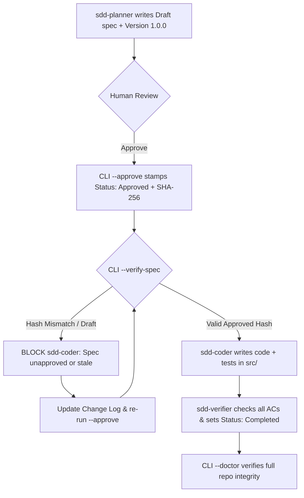

# SPEC-004: Spec Approval Lifecycle, Integrity Doctor & E2E Workflow Verification

> **Status:** `Completed`  
> **Version:** `1.0.0`  
> **Author:** Senior Tooling Engineer (via `sdd-planner`)  
> **Date:** 2026-11-10  
> **Approved-By:** `Tran Huu Quyet`  
> **Approved-At:** `2026-11-10T07:08:33.296Z`  
> **Approved-Hash:** `sha256:fb4b1eda6f3a12fc415b2f09285156b2b65d75eb2bf2f16ddcd070bc9c114e06`  
> **Target Path:** `.specify/templates/`, `.agents/skills/`, `create-nexus-kit/`

---

## 1. Overview & Objective

### 1.1 Problem Statement
1. Without cryptographic spec hashing and explicit approval gates, `sdd-coder` could accidentally implement from a `Draft` spec or a stale spec whose requirements were edited after human approval.
2. `--doctor` validates file existence, YAML frontmatter, and adapter cross-references, but does not verify spec lifecycle integrity, unapproved edits (hash drift), incomplete `Completed` specs, closed-loop skill chaining, or template parity inside the Nexus Kit source repository.
3. Automated tests verify individual unit behaviors, but lack an end-to-end workflow test proving `sdd-planner` -> Approval Gate -> Change Management -> `sdd-coder` -> `sdd-verifier` work seamlessly together.

### 1.2 Scope Boundaries
- **In-Scope:**
  - Canonical SHA-256 spec hashing (`computeSpecHash`), `--approve <spec-file>`, and `--verify-spec <spec-file>` commands in `create-nexus-kit/lib/nexus.js` and `bin/index.js`.
  - Spec template upgrade (`.specify/templates/spec-template.md`) adding `Version`, `Approved-By`, `Approved-At`, `Approved-Hash`, and `## Change Log`.
  - Upgrading `sdd-planner`, `sdd-coder`, and `sdd-verifier` to enforce approval checks, stale-hash drift detection, and change-log versioning.
  - Upgrading `--doctor` into a full Nexus Kit Integrity Validator (spec lifecycle & hash verification, AC completion check for `Completed` specs, closed-loop skill reference check, and CLI template parity check).
  - Comprehensive end-to-end workflow test suite (`create-nexus-kit/tests/e2e-workflow.test.js`) simulating a real feature lifecycle from scratch.
- **Out-of-Scope:**
  - External database storage or web UI for approvals.
  - Git hook auto-installation without explicit user consent.

---

## 2. Data Models & Contracts

### 2.1 Canonical Spec Hashing (`computeSpecHash`)
To allow status transitions (`Draft` -> `Approved` -> `In Progress` -> `Completed`) and verifier AC checkboxes (`- [ ]` -> `- [x]`) without false-positive tampering alerts, `computeSpecHash(rawMarkdown)` must:
1. Normalize line endings (`\r\n` -> `\n`).
2. Strip dynamic approval header lines (`> **Status:**`, `> **Approved-By:**`, `> **Approved-At:**`, `> **Approved-Hash:**`).
3. Normalize task checklist markers (`- [x]` / `- [X]` -> `- [ ]`).
4. Compute SHA-256 hex digest (`sha256:<64-hex-chars>`) of the trimmed canonical body.

### 2.2 CLI Commands
- `npx create-nexus-kit --approve <spec-path> [--by <approver>]`:
  - Computes canonical hash, updates `Status` to `Approved`, stamps `Approved-By`, `Approved-At`, and `Approved-Hash`.
- `npx create-nexus-kit --verify-spec <spec-path>`:
  - Verifies spec exists, `Status` is `Approved` or `In Progress`, and `Approved-Hash` matches live canonical hash. Exits `0` if ready for `sdd-coder`, `1` if unapproved or stale/tampered.

---

## 3. Logic Flow

---

## 4. Acceptance Criteria

- [x] **AC-1 (Canonical Hash & Approval CLI)**: `computeSpecHash`, `approveSpec`, and `verifySpecForCoding` exist and `--approve` / `--verify-spec` CLI flags execute cleanly.
- [x] **AC-2 (Stale / Unapproved Spec Blocking)**: Coder verification blocks `Draft`/`In Review` specs AND detects any post-approval edits to requirements/ACs via hash mismatch (`exitCode = 1`).
- [x] **AC-3 (Template & Change Log)**: `spec-template.md` includes `Version`, `Approved-By`, `Approved-At`, `Approved-Hash`, and `## Change Log` section.
- [x] **AC-4 (Upgraded Skills Triad)**: `sdd-planner`, `sdd-coder`, and `sdd-verifier` enforce spec approval gates, `--verify-spec`, and change-log versioning.
- [x] **AC-5 (Integrity Doctor)**: `--doctor` validates spec lifecycle/hashes, checks all ACs are checked when `Status: Completed`, validates closed-loop skill references, and checks template parity with `create-nexus-kit`.
- [x] **AC-6 (E2E Workflow Test)**: `tests/e2e-workflow.test.js` runs an automated end-to-end simulation covering scaffold -> draft block -> approve -> drift detection -> re-approve -> implementation & unit test execution -> verifier completion -> `--doctor` 0-fail pass.

---

## 5. Change Log

| Version | Date | Author | Summary |
| :--- | :--- | :--- | :--- |
| `1.0.0` | `2026-11-10` | `sdd-planner` | Initial specification for spec approval lifecycle, integrity doctor, and E2E verification. |
