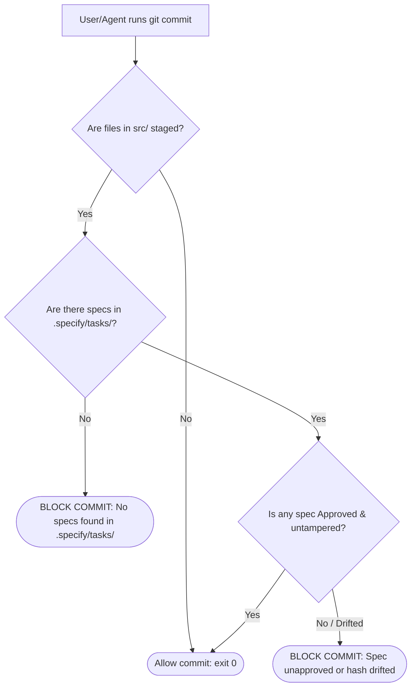

# SPEC-006: Git Hard Gates (Pre-commit Hook) & Modern AI IDE Adapters

> **Status:** `Completed`  
> **Version:** `1.0.0`  
> **Author:** `sdd-planner`  
> **Date:** 2026-11-16  
> **Approved-By:** `Tran Huu Quyet`  
> **Approved-At:** `2026-11-16T05:31:56.524Z`  
> **Approved-Hash:** `sha256:8434294874b2fb2686eadd93e58da6d464e0173f933ac265ac242591723c941d`  
> **Upstream Spec Kit:** Compatible with Spec Kit v1.0+  
> **Target Path:** `create-nexus-kit/`, `.github/`, `README.md`, `README.vi.md`

---

## 1. Overview & Objective

### 1.1 Problem Statement
1. Currently, the "NO VIBE CODING" rule is enforced solely through soft prompt instructions (`AGENTS.md`, `CLAUDE.md`, etc.). If an AI agent or a developer accidentally edits files in `src/` and runs `git commit`, Git allows the commit unconditionally even if no approved specification exists or if the spec was tampered with (hash drift).
2. Modern AI development has expanded rapidly beyond Cursor and Claude Code to newer agentic IDEs, specifically **Windsurf (Cascade)** (`.windsurfrules`) and **Cline / Roo Code** (`.clinerules`). Projects scaffolded by `nexus-kit` currently lack native rule adapters for these environments.
3. The project diagnostic command (`--doctor`) only validates Claude, Cursor, and Copilot adapters, leaving Windsurf, Cline, and Git hook configurations unverified.

### 1.2 User Stories
- **As a developer/tech lead**, I want a Git pre-commit hook that automatically blocks any `git commit` touching `src/` unless there is a matching, untampered `Approved` spec in `.specify/tasks/`, so that un-spec'd vibe coding is physically prevented in Git history.
- **As a Windsurf or Cline user**, I want `nexus-kit` to automatically generate `.windsurfrules` and `.clinerules` adapters upon scaffolding so my AI agent immediately inherits the SDD workflow.
- **As a team maintainer**, I want `nexus-kit --doctor` to verify the presence and integrity of all IDE adapters and report Git hook status.

### 1.3 Scope Boundaries
- **In-Scope:**
  - Implement `installGitPreCommitHook(targetDir)` in `create-nexus-kit/lib/nexus.js` to generate a standalone, zero-dependency executable `.git/hooks/pre-commit` hook.
  - Implement CLI command `nexus-kit init-hooks [target-dir]` (or `create-nexus-kit --init-hooks [target-dir]`) in `create-nexus-kit/bin/index.js`.
  - Add `--with-hooks` flag to `scaffoldProject` and CLI scaffolding commands to optionally initialize Git and pre-commit hooks during scaffolding.
  - Add templates `TEMPLATES.windsurfAdapter` (`.windsurfrules`) and `TEMPLATES.clineAdapter` (`.clinerules`) in `lib/nexus.js` and `install.sh`.
  - Update `scaffoldProject` in `lib/nexus.js` to generate `.windsurfrules` and `.clinerules`.
  - Upgrade `validateProject` (`--doctor`) to check `.windsurfrules`, `.clinerules`, and Git hook readiness.
  - Bump package version to `1.6.0` in `create-nexus-kit/package.json` and `lib/nexus.js`.
  - Add unit and E2E test suites in `create-nexus-kit/tests/cli.test.js` and `create-nexus-kit/tests/e2e-workflow.test.js`.
  - Update root documentation (`README.md`, `README.vi.md`, and `create-nexus-kit/README.md`).
- **Out-of-Scope:**
  - Server-side pre-receive git hooks (GitHub Enterprise / GitLab server hooks).
  - External npm dependencies (Husky, lint-staged) — the hook must remain 100% native Node.js / POSIX sh zero-dependency.
  - MCP server implementation (deferred to v2.0.0).

---

## 2. Data Models & Interface Contracts

### 2.1 Git Pre-Commit Hook Behavior
The generated `.git/hooks/pre-commit` file must:
1. Check if files in `src/` are staged for commit:
   `git diff --cached --name-only --diff-filter=ACMR` filtering for lines starting with `src/`.
2. If no staged files touch `src/` (e.g. documentation, configuration, tests only), exit cleanly (`exit 0`).
3. If files in `src/` are staged:
   - Check if `.specify/tasks/` contains at least one approved/completed specification file (`*-spec.md`).
   - If no valid specs exist, output error banner and fail commit (`exit 1`):
     ```text
     [NEXUS-KIT HARD GATE] Commit blocked!
     No Approved specification found in .specify/tasks/ covering staged changes in src/.
     Rule: NO VIBE CODING - Always plan and approve a spec first!
     ```
   - For every approved spec, verify its canonical hash via `verifySpecForCoding`. If hash mismatch (spec drift) occurs, output warning and block commit.
   - If at least one valid, untampered `Approved` or `Completed` spec exists covering the feature, allow commit (`exit 0`).

### 2.2 CLI Signature & Functions
- **Function:** `installGitPreCommitHook(targetDir, options = {})`
  - **Input:** `targetDir: string`, `options: { force?: boolean }`
  - **Output:** `{ success: boolean, hookPath: string, message: string }`
- **CLI Commands:**
  - `nexus-kit init-hooks [target-dir]`: Installs pre-commit hook into `.git/hooks/pre-commit` and ensures executable permissions (`chmod +x` / `0o755`).
  - `nexus-kit [project-name] --with-hooks`: Runs scaffolding and installs pre-commit hooks in one command.

### 2.3 IDE Adapter Specifications
- `.windsurfrules`:
  - Enforces: Read `.specify/constitution.md`, verify tasks in `.specify/tasks/`, execute SDD triad (`.agents/skills/`).
- `.clinerules`:
  - Enforces: Strict spec compliance, refusal to vibe-code into `src/` without approved hash, trigger `sdd-verifier` upon completion.

---

## 3. Logic Flow & State Transitions



---

## 4. Edge Cases & Error Handling

- [x] **Non-git Directory**: Running `init-hooks` in a folder without `.git` must fail gracefully with actionable error: `"Target directory is not a Git repository. Run 'git init' first."`
- [x] **Windows / Cross-Platform**: The hook must execute via `node` using cross-platform child process calls, or a dual POSIX/Windows sh runner.
- [x] **Existing Pre-commit Hook**: If `.git/hooks/pre-commit` already exists, prompt/skip unless `-f` or `--force` is specified.
- [x] **Merge/Rebase Commits**: The pre-commit hook must not interfere with automated git merge/rebase commits when no unstaged `src/` files are illegally staged.
- [x] **Executable Permissions**: On macOS/Linux, `fs.chmodSync(hookPath, 0o755)` must be applied so Git can execute the hook.

---

## 5. Acceptance Criteria

- [x] **AC-1 (Pre-commit Hook Generator)**: `installGitPreCommitHook` creates an executable pre-commit hook in `.git/hooks/pre-commit` that intercepts staged `src/` edits and verifies approved specs.
- [x] **AC-2 (CLI Command & Flags)**: CLI supports `nexus-kit init-hooks [target-dir]` and `nexus-kit <project> --with-hooks`.
- [x] **AC-3 (Windsurf & Cline Adapters)**: `scaffoldProject` and `install.sh` generate `.windsurfrules` and `.clinerules` alongside existing adapters.
- [x] **AC-4 (Doctor Diagnostic)**: `nexus-kit --doctor` verifies `.windsurfrules`, `.clinerules`, and reports whether Git pre-commit hooks are active.
- [x] **AC-5 (Automated Test Coverage)**: Unit and E2E tests verify hook installation, commit blocking of un-spec'd `src/` edits, and passing of spec'd commits.
- [x] **AC-6 (Documentation)**: `README.md`, `README.vi.md`, and `create-nexus-kit/README.md` document the new hard gates and adapters.

---

## 6. Change Log

| Version | Date | Author | Summary |
| :--- | :--- | :--- | :--- |
| `1.0.0` | `2026-11-16` | `sdd-planner` | Initial specification for Git hard gates (pre-commit hook) and Windsurf/Cline adapters (v1.6.0). |
