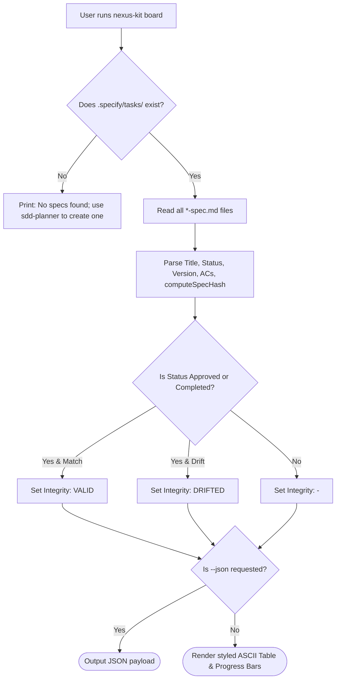

# SPEC-007: Terminal Status Board & Tech Stack Presets

> **Status:** `Completed`  
> **Version:** `1.0.0`  
> **Author:** `sdd-planner`  
> **Date:** 2026-11-16  
> **Approved-By:** `Tran Huu Quyet`  
> **Approved-At:** `2026-11-16T05:56:52.678Z`  
> **Approved-Hash:** `sha256:eac01992932a3ec336bf8007b893394e80091239fdec511d706cebc5557bbe94`  
> **Upstream Spec Kit:** Compatible with Spec Kit v1.0+  
> **Target Path:** `create-nexus-kit/`, `install.sh`, `README.md`, `README.vi.md`

---

## 1. Overview & Objective

### 1.1 Problem Statement
1. In projects scaling beyond a few features, developers and managers currently have to manually inspect individual `.specify/tasks/*-spec.md` markdown files to determine which features are Drafted, Approved, In Progress, or Completed, and whether any requirements drifted (hash mismatch).
2. Initializing a new project requires manually editing line 4 of `.specify/constitution.md` to declare the tech stack, otherwise `nexus-kit --doctor` persistently emits a warning (`[WARN] .specify/constitution.md found, but TECH STACK placeholder is unconfigured`). There are no pre-packaged stack presets for standard stacks (Next.js, FastAPI, NestJS, React/Vite, Node.js).

### 1.2 User Stories
- **As a developer / agent supervisor**, I want to run `nexus-kit board` (or `nexus-kit status`) to view a clean, styled terminal dashboard displaying all specs, versions, statuses, cryptographic drift states, and Acceptance Criteria progress bars.
- **As an automation / CI author**, I want to run `nexus-kit board --json` to export machine-readable task summaries for dashboarding and automated compliance checks.
- **As a project creator**, I want to pass `--preset nextjs` (or `fastapi`, `nestjs`, `react`, `node`) during scaffolding so `.specify/constitution.md` is automatically pre-configured with industry-standard technologies and passes `--doctor` with zero warnings out of the box.

### 1.3 Scope Boundaries
- **In-Scope:**
  - Implement `getTasksSummary(targetDir)` in `create-nexus-kit/lib/nexus.js` to parse task IDs, titles, versions, statuses, cryptographic drift, and AC checklist counts.
  - Implement `renderTasksBoard(targetDir, options = {})` in `create-nexus-kit/lib/nexus.js` with ANSI colors, progress bars, summary counts, and `--json` support.
  - Implement CLI subcommands `board` and `status` in `create-nexus-kit/bin/index.js`.
  - Define `PRESETS` dictionary in `lib/nexus.js` supporting `nextjs`, `fastapi`, `nestjs`, `react`, and `node` (with aliases `next`, `python`, `nest`, `vite`, `minimal`).
  - Add `--preset <name>` support in `scaffoldProject`, CLI, and `install.sh`.
  - Validate preset inputs and provide helpful error messages for unknown presets.
  - Bump package version to `1.7.0` in `package.json` and `lib/nexus.js`.
  - Add unit and E2E test suites in `cli.test.js` and `e2e-workflow.test.js`.
  - Update root documentation (`README.md`, `README.vi.md`, `create-nexus-kit/README.md`).
- **Out-of-Scope:**
  - Interactive terminal cursor navigation (keeping zero-dependency philosophy, avoiding `blessed` or `ink`).
  - Web UI / browser dashboard (deferred to future web tooling).

---

## 2. Data Models & Interface Contracts

### 2.1 Task Summary Data Model
```typescript
export interface TaskSummary {
  id: string;               // e.g. "001", "006"
  filename: string;         // e.g. "001-slugify-spec.md"
  title: string;            // e.g. "Deterministic URL Slugify Utility"
  version: string;          // e.g. "1.0.0"
  status: string;           // "Draft" | "In Review" | "Approved" | "In Progress" | "Completed" | "Superseded"
  hashStatus: 'VALID' | 'DRIFTED' | 'UNAPPROVED'; // Cryptographic verification status
  acTotal: number;          // Total number of Acceptance Criteria
  acDone: number;           // Completed Acceptance Criteria count
  progressPercent: number;  // 0 - 100
  targetPath?: string;      // Target implementation path
}
```

### 2.2 Presets Definition Contract
```typescript
export interface StackPreset {
  name: string;
  techStack: string;
}

export const PRESETS: Record<string, StackPreset> = {
  nextjs: {
    name: 'Next.js 15 (App Router)',
    techStack: 'TypeScript 5, Next.js 15 (App Router), Tailwind CSS, Vitest, Zod'
  },
  fastapi: {
    name: 'Python FastAPI',
    techStack: 'Python 3.12, FastAPI, Pydantic v2, Pytest, SQLAlchemy'
  },
  nestjs: {
    name: 'NestJS Backend',
    techStack: 'TypeScript 5, NestJS 10, Jest, Prisma'
  },
  react: {
    name: 'React 19 + Vite',
    techStack: 'TypeScript 5, Vite, React 19, Tailwind CSS, Vitest'
  },
  node: {
    name: 'Node.js (ES Modules)',
    techStack: 'Node.js 20+ (ES Modules), Vitest'
  }
};
```

### 2.3 CLI Commands
- `npx create-nexus-kit@latest board [target-dir] [--json]`
- `npx create-nexus-kit@latest status [target-dir] [--json]`
- `npx create-nexus-kit@latest my-app --preset nextjs`
- `npx create-nexus-kit@latest . --preset fastapi --force`

---

## 3. Logic Flow & State Transitions



---

## 4. Edge Cases & Error Handling

- [x] **Empty Tasks Directory**: When `.specify/tasks/` contains only `.gitkeep` or 0 specs, `board` prints a friendly status message with guidance on planning with `sdd-planner`.
- [x] **Invalid or Unknown Preset**: Passing `--preset invalid-stack` outputs a list of supported presets (`nextjs`, `fastapi`, `nestjs`, `react`, `node`) and exits with code 1.
- [x] **Specs without ACs**: If a draft spec contains 0 checkboxes, `acTotal` is 0 and progress is displayed as `0%` without `NaN` division errors.
- [x] **Corrupted / Malformed Spec**: Individual malformed files display a warning line on the board without aborting the rendering of other valid specs.
- [x] **Non-TTY Output / Piped Commands**: The board respects plain text output when piped or when `--json` is supplied.

---

## 5. Acceptance Criteria

- [x] **AC-1 (Task Summary Extractor)**: `getTasksSummary` parses all spec files, extracts metadata, evaluates AC progress, and verifies cryptographic integrity against `Approved-Hash`.
- [x] **AC-2 (Terminal Status Board CLI)**: `nexus-kit board` and `nexus-kit status` render an ASCII matrix with colored badges, progress bars, and aggregate counts.
- [x] **AC-3 (JSON Output Mode)**: Passing `--json` to `board` or `status` emits structured JSON to stdout.
- [x] **AC-4 (Tech Stack Presets)**: `scaffoldProject` supports `--preset` configuring line 4 of `.specify/constitution.md` with pre-defined technology guidelines.
- [x] **AC-5 (Doctor Parity with Presets)**: Projects scaffolded with a valid `--preset` pass `nexus-kit --doctor` without unconfigured tech stack warnings.
- [x] **AC-6 (Test Coverage & Documentation)**: Unit and E2E tests verify board rendering, JSON export, preset scaffolding, and docs are updated in `README.md`, `README.vi.md`, and `create-nexus-kit/README.md`.

---

## 6. Change Log

| Version | Date | Author | Summary |
| :--- | :--- | :--- | :--- |
| `1.0.0` | `2026-11-16` | `sdd-planner` | Initial specification for Terminal Status Board and Tech Stack Presets (v1.7.0). |
