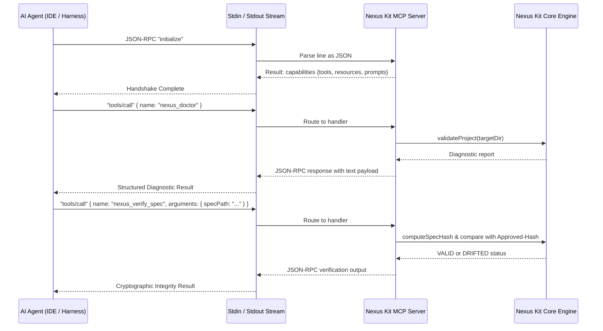

# SPEC-008: Native Model Context Protocol (MCP) Server for Nexus Kit

> **Status:** `Completed`  
> **Version:** `1.0.0`  
> **Author:** `sdd-planner`  
> **Date:** 2026-11-16  
> **Approved-By:** `quyettranhuu`  
> **Approved-At:** `2026-11-16T06:15:53.217Z`  
> **Approved-Hash:** `sha256:c1811f19a5d581f56fa4f6c0f4fa6e8a8aa698e70b347ee0eb321ee6d0fcbbc4`  
> **Upstream Spec Kit:** Compatible with Spec Kit v1.0+  
> **Target Path:** `create-nexus-kit/`, `README.md`, `README.vi.md`

---

## 1. Overview & Objective

### 1.1 Problem Statement
1. Currently, AI agents (Antigravity, Cursor, Claude Code, Windsurf, Cline) interact with Nexus Kit primarily through static markdown instruction files (`AGENTS.md`, `CLAUDE.md`, `.windsurfrules`, `.clinerules`, `.cursor/rules/nexus-kit.mdc`) and child process shell executions (`npx create-nexus-kit --doctor`, `board`, `--approve`).
2. As modern AI agent architectures converge on the **Model Context Protocol (MCP)** (the open industry standard created by Anthropic), agents perform best when they have native structured RPC access to project state rather than having to parse terminal text outputs or guess file structures.
3. Without a native MCP server, agent-driven workflows cannot programmatically query project rules, inspect task approval hashes, or trigger SDD doctor diagnostics via standard tool calling inside their native IDE harnesses.

### 1.2 User Stories
- **As an AI Agent (Claude Code, Cursor, Antigravity, Windsurf, Cline)**, I want to connect to Nexus Kit via MCP over stdio so that I can invoke structured tools (`nexus_check_constitution`, `nexus_get_specs`, `nexus_verify_spec`, `nexus_doctor`, `nexus_create_spec`, `nexus_approve_spec`) directly during coding sessions.
- **As an AI Agent Supervisor**, I want agents to access read-only resources (`nexus://constitution`, `nexus://specs`, `nexus://board`) without risk of hallucinating project rules.
- **As a developer**, I want to start the MCP server using `nexus-kit mcp` (or `create-nexus-kit mcp`) with zero external runtime dependencies and instant startup time.

### 1.3 Scope Boundaries
- **In-Scope:**
  - Implement a zero-dependency, JSON-RPC 2.0 compliant MCP stdio server in `create-nexus-kit/lib/mcp.js`.
  - Expose CLI subcommand `nexus-kit mcp` (and alias `serve-mcp`) in `create-nexus-kit/bin/index.js`.
  - Implement MCP Tools:
    - `nexus_check_constitution`: Reads and checks `.specify/constitution.md`.
    - `nexus_get_specs`: Returns all specs, statuses, progress bars, and drift states.
    - `nexus_verify_spec`: Verifies cryptographic SHA-256 integrity hash of a specific spec or all specs.
    - `nexus_doctor`: Runs comprehensive repository diagnostics and returns structured JSON/text diagnostics.
    - `nexus_create_spec`: Generates a standard task spec draft template in `.specify/tasks/`.
    - `nexus_approve_spec`: Approves a spec and stamps it with canonical SHA-256 hash.
  - Expose MCP Resources:
    - `nexus://constitution`: Returns raw contents and metadata of project constitution.
    - `nexus://specs`: Returns JSON summary list of all project specs.
    - `nexus://board`: Returns rendered ASCII terminal board.
  - Expose MCP Prompts:
    - `sdd_plan`: Guides agent through Spec-Driven Development planning phase.
    - `sdd_implement`: Guides agent through strict In-Scope coding phase.
    - `sdd_verify`: Guides agent through acceptance criteria audit and sign-off.
  - Add configuration snippet / template for IDEs (`.cursor/mcp.json`, Claude Desktop config).
  - Version bump to `2.0.0` in `package.json` and `lib/nexus.js`.
  - Full automated unit tests and integration tests in `create-nexus-kit/tests/mcp.test.js`.
  - Update documentation (`README.md`, `README.vi.md`, `create-nexus-kit/README.md`).
- **Out-of-Scope:**
  - SSE / HTTP transport (stdio is the gold standard for local CLI / IDE agents; network transport introduces authentication and port-binding complexity).
  - External heavy MCP SDK dependencies (maintains zero-dependency, pure Node.js stdio implementation).

---

## 2. Data Models & Interface Contracts

### 2.1 JSON-RPC 2.0 Protocol Envelope
```typescript
export interface JsonRpcRequest {
  jsonrpc: '2.0';
  id?: string | number;
  method: string;
  params?: Record<string, any>;
}

export interface JsonRpcResponse {
  jsonrpc: '2.0';
  id: string | number;
  result?: any;
  error?: {
    code: number;
    message: string;
    data?: any;
  };
}
```

### 2.2 MCP Protocol Methods
1. **`initialize`**:
   - Request: `{ clientInfo: { name: string, version: string }, protocolVersion: string, capabilities: object }`
   - Response: `{ protocolVersion: '2024-11-05', serverInfo: { name: 'nexus-kit', version: '2.0.0' }, capabilities: { tools: {}, resources: {}, prompts: {} } }`
2. **`tools/list`**: Returns definitions of all supported tools with JSON Schema input definitions.
3. **`tools/call`**: Invokes tool with arguments `{ name: string, arguments: object }` and returns `{ content: [{ type: 'text', text: string }] }`.
4. **`resources/list`**: Returns available URI resources (`nexus://constitution`, `nexus://specs`, `nexus://board`).
5. **`resources/read`**: Returns contents of requested URI.
6. **`prompts/list`**: Returns available prompts (`sdd_plan`, `sdd_implement`, `sdd_verify`).
7. **`prompts/get`**: Returns prompt message contents for given name.

### 2.3 Tool Signatures
- **`nexus_check_constitution`**: `{ targetDir?: string }`
- **`nexus_get_specs`**: `{ targetDir?: string }`
- **`nexus_verify_spec`**: `{ specPath?: string, targetDir?: string }`
- **`nexus_doctor`**: `{ targetDir?: string }`
- **`nexus_create_spec`**: `{ id: string, title: string, author?: string, targetPath?: string, targetDir?: string }`
- **`nexus_approve_spec`**: `{ specPath: string, by?: string }`

---

## 3. Logic Flow & State Transitions



---

## 4. Edge Cases & Error Handling

- [x] **Malformed JSON Input**: When a non-JSON string is sent over stdin, server responds with standard JSON-RPC error `code: -32700 (Parse error)` without crashing.
- [x] **Unknown Method**: When an unknown RPC method is requested, server responds with `code: -32601 (Method not found)`.
- [x] **Unknown Tool Name**: When `tools/call` is invoked with a non-existent tool, server responds with clear error explanation.
- [x] **Missing Project Files**: If tools are run in a directory without `.specify/`, tools return friendly actionable warnings instead of throwing unhandled exceptions.
- [x] **Empty Stdio Line**: Whitespace-only or blank lines sent over stdin are ignored safely.

---

## 5. Acceptance Criteria

- [x] **AC-1 (Zero-Dependency Stdio MCP Server)**: Implement `runMcpServer(options)` in `create-nexus-kit/lib/mcp.js` handling newline-delimited JSON-RPC 2.0 communication over `process.stdin` / `process.stdout`.
- [x] **AC-2 (CLI Subcommand)**: `npx create-nexus-kit mcp` (and `serve-mcp`) boots the MCP server with clean stdio routing and exits cleanly on `SIGINT` / `SIGTERM` or stdin EOF.
- [x] **AC-3 (Core MCP Tools)**: Implements all 6 tools (`nexus_check_constitution`, `nexus_get_specs`, `nexus_verify_spec`, `nexus_doctor`, `nexus_create_spec`, `nexus_approve_spec`) with complete parameter validation and structured outputs.
- [x] **AC-4 (MCP Resources)**: Exposes `nexus://constitution`, `nexus://specs`, and `nexus://board` through `resources/list` and `resources/read`.
- [x] **AC-5 (MCP Prompts)**: Exposes `sdd_plan`, `sdd_implement`, and `sdd_verify` prompts through `prompts/list` and `prompts/get`.
- [x] **AC-6 (Automated MCP Test Suite)**: Unit and integration tests verify JSON-RPC handshake, tool invocation, error codes, and resource reads over simulated stdio streams.
- [x] **AC-7 (Documentation & Version 2.0.0)**: Package version bumped to `2.0.0`, IDE setup guide (Cursor `.cursor/mcp.json`, Claude Desktop) documented in `README.md`, `README.vi.md`, and `create-nexus-kit/README.md`.

---

## 6. Change Log

| Version | Date | Author | Summary |
| :--- | :--- | :--- | :--- |
| `1.0.0` | `2026-11-16` | `sdd-planner` | Initial specification for Native Model Context Protocol (MCP) Server (v2.0.0). |
