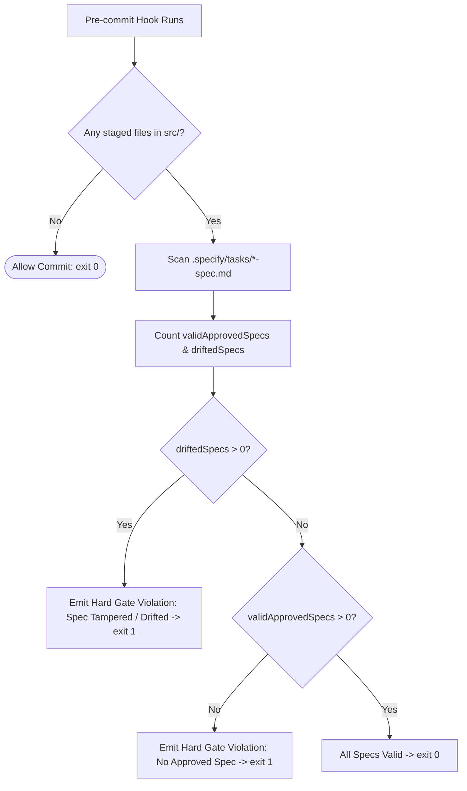

# SPEC-009: Security Hardening, Vulnerability Patches & Quality Refactoring

> **Status:** `Completed`  
> **Version:** `1.0.0`  
> **Author:** `sdd-planner`  
> **Date:** 2026-11-16  
> **Approved-By:** `quyettranhuu`  
> **Approved-At:** `2026-11-16T09:06:00.755Z`  
> **Approved-Hash:** `sha256:75bc9e458bf8b16e4da56bffc127375adab48cf1550bb6ad63886bdcd7b9efdf`  
> **Upstream Spec Kit:** Compatible with Spec Kit v1.0+  
> **Target Path:** `create-nexus-kit/lib/`, `create-nexus-kit/install.sh`, `create-nexus-kit/tests/`

---

## 1. Overview & Objective

### 1.1 Problem Statement
Following the v2.0.0 code review and quality audit, several security risks, logic flaws, and architectural debt were discovered:
1. **Path Traversal Risk**: `createSpecDraft` in `lib/mcp.js` interpolates the `id` argument directly into the filename without stripping directory traversal tokens (`..`, `/`), allowing arbitrary file creation outside `.specify/tasks/`.
2. **Arbitrary File Corruption**: `approveSpec` does not validate that the target file is a Markdown specification (`*.md`), allowing accidental or malicious overwrite of arbitrary files (e.g. `package.json`).
3. **Pre-commit Drift Bypass**: The Git pre-commit hook only checks if `validApprovedSpecs === 0`. If at least one valid spec exists, it merely logs a warning on `driftedSpecs > 0` and permits the commit, failing to enforce hard gates against tampered requirements.
4. **Missing ANSI Variable**: `install.sh` uses `${RED}` on line 71 without declaring `RED` in the color codes block.
5. **Heading Boundary Leak**: `extractSectionContent` only terminates on `## ` (H2), leaking content into the section if an H1 (`# `) appears subsequently.
6. **Monolithic Module Debt**: `lib/nexus.js` has grown to 1,364 lines, tightly coupling static templates (`TEMPLATES`), presets (`PRESETS`), core logic, and diagnostics.

### 1.2 User Stories
- **As an AI Agent Supervisor**, I want `nexus_create_spec` and `nexus_approve_spec` to strictly validate inputs so that prompt injection or agent confusion cannot escape tasks directories or corrupt project files.
- **As a Tech Lead**, I want the Git pre-commit hard gate to physically reject commits if ANY spec is in a drifted state (`driftedSpecs > 0`).
- **As a Developer / Maintainer**, I want `lib/nexus.js` decomposed into focused modules (`lib/templates.js`, `lib/presets.js`) with zero breaking changes for existing callers.

### 1.3 Scope Boundaries
- **In-Scope:**
  - Sanitize `id` in `createSpecDraft` using `replace(/[^a-zA-Z0-9_-]/g, '')` and reject invalid/empty IDs.
  - Require `specPath` in `approveSpec` to be an existing Markdown file (`.md`) located in a valid path.
  - Update `TEMPLATES.preCommitHook` to terminate with `exit 1` whenever `driftedSpecs > 0`.
  - Add `RED='\033[1;31m'` to `create-nexus-kit/install.sh`.
  - Update `extractSectionContent` to terminate on any `# ` or `## ` heading.
  - Extract `TEMPLATES` into `create-nexus-kit/lib/templates.js` and `PRESETS` into `create-nexus-kit/lib/presets.js`, re-exporting them in `lib/nexus.js`.
  - Bump package version to `2.0.1` in `package.json` and `lib/nexus.js`.
  - Add comprehensive regression test suites covering path traversal, file validation, drift blocking, and heading boundary parsing.
- **Out-of-Scope:**
  - Adding new CLI subcommands or changing existing public API signatures.
  - Network / SSE transport changes for MCP.

---

## 2. Data Models & Interface Contracts

### 2.1 Sanitization Schema for `createSpecDraft`
```typescript
export interface CreateSpecDraftOptions {
  id: string;          // Must contain at least one valid alphanumeric character; sanitized to [a-zA-Z0-9_-]
  title: string;       // Non-empty string; slugified to kebab-case
  author?: string;     // Default: 'sdd-planner'
  targetPath?: string; // Default: 'src/...'
  targetDir?: string;  // Project root directory
}
```

### 2.2 Pre-commit Hook Exit Contract
- `stagedFiles.length === 0` -> `exit 0` (no changes in `src/`)
- `validApprovedSpecs === 0` -> `exit 1` (no approved specs exist)
- `driftedSpecs > 0` -> `exit 1` (at least one spec was modified after approval without re-approval)
- `validApprovedSpecs > 0 && driftedSpecs === 0` -> `exit 0` (clean commit allowed)

---

## 3. Logic Flow & State Transitions



---

## 4. Edge Cases & Error Handling

- [x] **Path Traversal in `createSpecDraft`**: Inputs like `../../malicious`, `/root/test`, or `..` are strictly sanitized and trapped inside `.specify/tasks/` or throw a descriptive error.
- [x] **Invalid File in `approveSpec`**: Passing a non-markdown file (`package.json`) throws `Error: Target file must be a markdown specification (*.md)`.
- [x] **Simultaneous Valid & Drifted Specs in Pre-commit**: Having 1 valid completed spec and 1 drifted spec blocks the commit with exit code 1.
- [x] **Missing Color Code in Bash**: Executing `install.sh --preset invalid` displays the red failure banner cleanly.
- [x] **H1 Heading Boundary**: Section extractor stops at `# ` as well as `## `.

---

## 5. Acceptance Criteria

- [x] **AC-1 (Path Traversal Protection)**: `createSpecDraft` sanitizes `id`, enforces non-empty alphanumeric identifiers, and guarantees files are created strictly within `.specify/tasks/`.
- [x] **AC-2 (Spec File Boundary)**: `approveSpec` validates that `specPath` ends with `.md` before reading or writing.
- [x] **AC-3 (Pre-commit Zero-Tolerance Drift Gate)**: `preCommitHook` exits with code 1 if `driftedSpecs > 0`, blocking commits when requirements have drifted.
- [x] **AC-4 (Bash Color Code Fix)**: `RED` ANSI variable is declared in `create-nexus-kit/install.sh`.
- [x] **AC-5 (Heading Parser Robustness)**: `extractSectionContent` properly terminates upon encountering either H1 (`# `) or H2 (`## `) headings.
- [x] **AC-6 (Modular Architecture)**: `TEMPLATES` and `PRESETS` are extracted into dedicated modules (`lib/templates.js` and `lib/presets.js`) and re-exported, keeping `lib/nexus.js` lean and preserving 100% backward compatibility.
- [x] **AC-7 (Regression Test Suite & Version Bump)**: All 37 existing tests + new regression tests pass with 0 failures, and package version is bumped to `2.0.1`.

---

## 6. Change Log

| Version | Date | Author | Summary |
| :--- | :--- | :--- | :--- |
| `1.0.0` | `2026-11-16` | `sdd-planner` | Initial specification for security hardening and quality refactoring (v2.0.1). |
