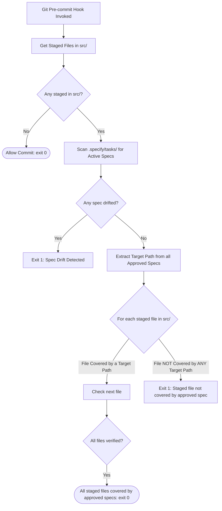

# SPEC-010: Governance Hardening, Anti-Self-Approval & Scoped Git Gates

> **Status:** `Completed`  
> **Version:** `1.0.0`  
> **Author:** `sdd-planner`  
> **Date:** 2026-11-16  
> **Approved-By:** `quyettranhuu`  
> **Approved-At:** `2026-11-16T09:52:53.810Z`  
> **Approved-Hash:** `sha256:8d183442402d443176ac0de20dde20aa2fbdc8c6ac2ed0322654b4275ce86d90`  
> **Upstream Spec Kit:** Compatible with Spec Kit v1.0+  
> **Target Path:** `create-nexus-kit/lib/`, `create-nexus-kit/tests/`, `README.md`, `README.vi.md`

---

## 1. Overview & Objective

### 1.1 Problem Statement
1. **AI Self-Approval Vulnerability**: `nexus_approve_spec` is currently exposed as an MCP tool, allowing autonomous AI agents to approve their own specifications without human oversight, breaking the core "NO VIBE CODING - Human Approval Gate" law.
2. **Silent Spec Overwrite**: `createSpecDraft` overwrites existing specification files unconditionally, risking destructive loss of reviewed specifications and approved cryptographic hashes.
3. **Unbounded Spec Approval**: `approveSpec` only checks for `.md` extensions, allowing corruption of arbitrary Markdown files (`README.md`, `constitution.md`, external docs) if passed as arguments.
4. **Coarse-Grained Git Hard Gate**: The Git pre-commit hook only checks if *any* approved spec exists in `.specify/tasks/`. If a legacy approved spec exists, unstaged or un-spec'd files staged in `src/` bypass the gate completely.
5. **Empirical Test Gaps**: Automated tests do not explicitly verify self-approval removal, non-overwrite spec creation, file boundary rejection, or scoped file path matching in the pre-commit hook.

### 1.2 User Stories
- **As a Project Owner / Lead**, I want approval to be an exclusive human action via CLI terminal, ensuring AI agents cannot self-approve specifications via MCP.
- **As a Developer**, I want `createSpecDraft` to fail safely if a specification file already exists unless `force: true` is explicitly provided.
- **As a System Maintainer**, I want `approveSpec` to strictly require targets to be valid specification files (`*-spec.md` or `.spec.md`) inside `.specify/tasks/`.
- **As a Quality Engineer**, I want the Git pre-commit hook to inspect every individual staged file in `src/` and verify that each file is covered by an active, approved spec's `Target Path`.

### 1.3 Scope Boundaries
- **In-Scope:**
  - Remove `nexus_approve_spec` from `MCP_TOOLS` in `create-nexus-kit/lib/mcp.js`.
  - Add non-overwrite protection to `createSpecDraft` in `create-nexus-kit/lib/mcp.js` (throw error if file exists unless `options.force === true`).
  - Restrict `approveSpec` in `create-nexus-kit/lib/nexus.js` to files inside `.specify/tasks/`, matching `*spec.md`, and containing a valid Spec heading.
  - Upgrade `TEMPLATES.preCommitHook` in `create-nexus-kit/lib/templates.js` to implement fine-grained **Scoped Target Path Mapping**: every staged file in `src/` must match the `Target Path` of an approved/completed/in-progress spec with valid hash.
  - Bump package version to `2.1.0` in `package.json` and `lib/nexus.js`.
  - Add empirical automated regression tests for all 5 fixes in `create-nexus-kit/tests/`.
  - Update documentation to reflect human-exclusive approval and scoped gate enforcement.
- **Out-of-Scope:**
  - Remote Git server pre-receive hooks.
  - Custom regex patterns for spec file naming.

---

## 2. Data Models & Interface Contracts

### 2.1 MCP Tools Surface (Human-Exclusive Approval)
The exposed MCP tools list MUST NOT contain `nexus_approve_spec`:
- `nexus_check_constitution`
- `nexus_get_specs`
- `nexus_verify_spec`
- `nexus_doctor`
- `nexus_create_spec`

### 2.2 `createSpecDraft` Non-Overwrite Contract
```typescript
export interface CreateSpecDraftOptions {
  id: string;
  title: string;
  author?: string;
  targetPath?: string;
  targetDir?: string;
  force?: boolean; // Default: false. If file exists and force !== true, throws Error.
}
```

### 2.3 `approveSpec` Path Boundary Contract
`approveSpec(specPath, options)` must validate:
1. `specPath` must resolve within `<targetDir>/.specify/tasks/`.
2. Filename must match `/[A-Za-z0-9_-]+(-spec|\.spec)\.md$/`.
3. Content must match `/^#\s*(?:\[?SPEC-)?([A-Za-z0-9-]+)\]?:\s*(.+)$/m`.

### 2.4 Scoped Pre-Commit Path Mapping Contract
For each staged file `F` in `src/`:
1. Find all active specs with `status ∈ {Approved, Completed, In Progress}` and `liveHash === approvedHash`.
2. Check if `F` starts with `targetPath` (if `targetPath` ends with `/` or represents a directory) or equals `targetPath`.
3. If any `F` is uncovered by all valid specs:
   - Print violation with uncovered files and valid covered paths.
   - Exit with code 1.

---

## 3. Logic Flow & State Transitions



---

## 4. Edge Cases & Error Handling

- [x] **AI calls `nexus_approve_spec`**: Tool does not exist; server returns unknown tool error.
- [x] **Duplicate spec creation without force**: Calling `createSpecDraft` when file exists throws descriptive error without modifying the file.
- [x] **Approval of `README.md`**: Running `nexus-kit --approve README.md` throws error rejecting files outside `.specify/tasks/`.
- [x] **Staged file outside approved spec Target Path**: If spec covers `src/auth/` but `src/payment.js` is staged, commit is rejected with code 1.
- [x] **Directory vs File Target Path**: `Target Path: src/auth/` covers `src/auth/login.js` and `src/auth/token.js`. `Target Path: src/utils/slugify.js` covers only that file.

---

## 5. Acceptance Criteria

- [x] **AC-1 (No AI Self-Approval)**: `nexus_approve_spec` is removed from `MCP_TOOLS`. Approval remains strictly human via CLI.
- [x] **AC-2 (Spec Non-Overwrite Safety)**: `createSpecDraft` rejects existing files unless `options.force === true`.
- [x] **AC-3 (Strict Spec Path & Format Boundary)**: `approveSpec` strictly validates that the target file is inside `.specify/tasks/`, ends with `-spec.md` or `.spec.md`, and contains a valid Spec heading.
- [x] **AC-4 (Scoped Git Hard Gate)**: `preCommitHook` checks every staged file in `src/` against the `Target Path` metadata of approved specs, blocking commits if any staged file is uncovered.
- [x] **AC-5 (Automated Test Proof)**: Comprehensive test suites verify: AI cannot call approve tool, existing specs cannot be overwritten without force, non-spec files cannot be approved, and un-covered files in `src/` are blocked by git hook.
- [x] **AC-6 (Version Bump & Docs)**: Bump to `2.1.0` and update documentation.

---

## 6. Change Log

| Version | Date | Author | Summary |
| :--- | :--- | :--- | :--- |
| `1.0.0` | `2026-11-16` | `sdd-planner` | Initial specification for Governance Hardening, Anti-Self-Approval & Scoped Git Gates (v2.1.0). |
