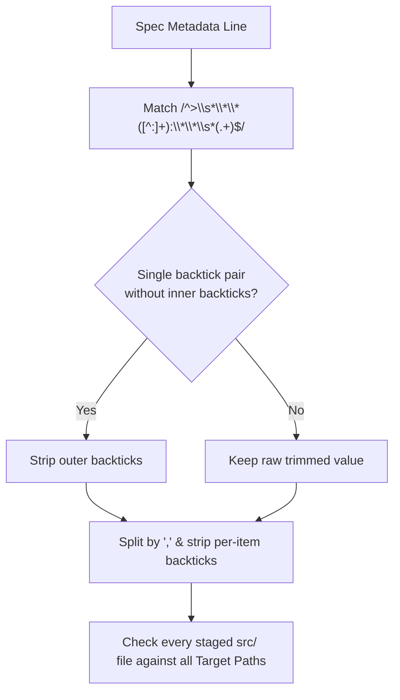

# SPEC-011: Bug Fixes, Parser Alignment & Install Script Parity

> **Status:** `Completed`  
> **Version:** `1.0.0`  
> **Author:** `sdd-planner`  
> **Date:** 2026-11-18  
> **Approved-By:** `quyettranhuu`  
> **Approved-At:** `2026-11-18T15:15:30.215Z`  
> **Approved-Hash:** `sha256:5fe9ab29f89d97b012451e993e27916eb973ff4dab26d1d887ca88d3d7e0d5c2`  
> **Upstream Spec Kit:** Compatible with Spec Kit v1.0+  
> **Target Path:** `create-nexus-kit/lib/`, `create-nexus-kit/bin/`, `create-nexus-kit/install.sh`, `create-nexus-kit/tests/`, `create-nexus-kit/package.json`, `.gitignore`

---

## 1. Overview & Objective

### 1.1 Problem Statement
A comprehensive zero-trust audit of `v2.1.0` revealed several real correctness, parity, and edge-case bugs across the CLI, MCP server, pre-commit hook, and shell installer:
1. **`install.sh` Stale Pre-Commit Hook**: `create-nexus-kit/install.sh` was not updated in `SPEC-010`, leaving shell-script installations with the legacy pre-commit hook that lacks drift blocking and Scoped Target Path enforcement.
2. **Broken Multi-Value & Space-Key Metadata Parsing**:
   - `parseSpecMetadata` in `lib/nexus.js` uses `[A-Za-z-]+`, which fails to match keys containing spaces such as `Target Path` or `Upstream Spec Kit`, making `meta['Target Path']` always `undefined`.
   - `parseMeta` in `TEMPLATES.preCommitHook` uses `` [^\x60\r\n]+ ``, stopping at the first closing backtick and truncating multi-value `Target Path` lists (e.g., `` `src/auth/`, `src/utils/` `` loses `src/utils/`).
3. **Hash Normalization Mismatch (`*` vs `-`)**: `computeSpecHash` in `lib/nexus.js` only normalizes `- [x]` checkboxes, while the pre-commit hook normalizes both `- [x]` and `* [x]`, causing potential hash drift false positives.
4. **MCP `nexus_verify_spec` Missing `In Progress` Handling**: `lib/mcp.js` checks `Approved` and `Completed` but omits `In Progress`, causing valid `In Progress` specs to return `valid: false` via MCP despite passing CLI `--verify-spec`.
5. **Overly Broad AC Counting**: `getTasksSummary` in `lib/nexus.js` counts all checkboxes in a spec (including Section 4 Edge Cases) as Acceptance Criteria instead of strictly prioritizing `**AC-` criteria when present.
6. **YAML Frontmatter Parser Edge Cases**: `parseYamlFrontmatter` does not strip UTF-8 BOM (`\uFEFF`), joins literal block scalars (`|` / `|-`) with spaces instead of newlines, and lacks a `val.length >= 2` guard on quoted values.
7. **CLI Next-Steps Numbering Bug**: `bin/index.js` prints steps `1, 3, 4, 5, 6` (skipping `2`) when scaffolding into `.` (`isCurrentDir === true`).
8. **Package Metadata, Hygiene & Test Coverage Gaps**: `package.json` lacks `engines.node`, `.gitignore` lacks `nexus-kit-app/`, and critical paths (`verifySpecForCoding`, `parseSpecMetadata`, `computeSpecHash`, multi-value & wildcard `Target Path`, MCP `In Progress` & `force: true`) lack direct automated regression tests.

### 1.2 User Stories
- **As a Shell Installer User (`curl | bash`)**, I want `install.sh --with-hooks` to install the exact same v2.1+ drift-checking and Scoped Target Path pre-commit hook as the Node CLI.
- **As a Developer**, I want multi-value `Target Path` metadata (e.g. `` `src/auth/`, `src/utils/` ``) to be parsed accurately by both `nexus.js` and the Git pre-commit hook without truncation.
- **As an AI Agent via MCP**, I want `nexus_verify_spec` to verify `In Progress` specifications consistently with the CLI `--verify-spec`.
- **As a Maintainer**, I want every critical parser, gate, and edge case covered by deterministic, non-flaky automated tests.

### 1.3 Scope Boundaries
- **In-Scope:**
  - Sync `create-nexus-kit/install.sh` pre-commit hook with `TEMPLATES.preCommitHook` (drift detection + Scoped Target Path + fixed `parseMeta` & `computeHash`).
  - Fix `parseSpecMetadata` in `lib/nexus.js` and `parseMeta` in `lib/templates.js` to support spaced keys (`Target Path`) and multi-value backtick-separated paths.
  - Align `computeSpecHash` in `lib/nexus.js` and `computeHash` in `lib/templates.js` to identically normalize `/^(\s*[-*]\s*)\[[xX]\]/gm` to `$1[ ]`.
  - Fix `nexus_verify_spec` in `lib/mcp.js` to validate `In Progress` specs identically to `Approved`/`Completed`.
  - Fix `getTasksSummary` in `lib/nexus.js` to count `**AC-` lines specifically when AC checkboxes exist (falling back to generic checkboxes only if no `**AC-` items exist).
  - Fix `parseYamlFrontmatter` in `lib/nexus.js` for UTF-8 BOM, `|`/`|-` literal newline preservation, and `val.length >= 2` quote guard.
  - Fix step numbering in `bin/index.js` when `isCurrentDir` is true.
  - Add `"engines": { "node": ">=18.0.0" }` to `create-nexus-kit/package.json` and bump version to `2.1.1`.
  - Clean up untracked `nexus-kit-app/` and add `nexus-kit-app/` to root `.gitignore`.
  - Add comprehensive unit, MCP, and E2E regression tests covering every fix and eliminate readline/timeout flakiness in `tests/mcp.test.js`.
- **Out-of-Scope:**
  - Breaking changes to CLI flags, MCP tool names, or existing spec template structure.
  - Rewriting `install.sh` in another language.

---

## 2. Data Models & Interface Contracts

### 2.1 Metadata Extraction Contract (`parseSpecMetadata` & Hook `parseMeta`)
- Line regex: `/^>\s*\*\*([^:]+):\*\*\s*(.+)$/`
- Backtick unwrapping:
  - Only strip outer backticks if `val.startsWith('`') && val.endsWith('`') && val.length >= 2` AND there are no internal backticks separating multiple items (e.g., `` `a`, `b` `` must preserve comma-separated items, which are split and stripped individually when parsing `Target Path`).
- Example:
  - Input: `` > **Target Path:** `src/auth/`, `src/utils/slugify.js`   ``
  - `meta['Target Path']` preserves both `src/auth/` and `src/utils/slugify.js`.
  - Split target paths: `['src/auth/', 'src/utils/slugify.js']`.

### 2.2 Canonical Hash Alignment Contract
Both `lib/nexus.js:computeSpecHash` and `lib/templates.js` / `install.sh` pre-commit hook `computeHash` MUST compute identical SHA-256 digests using:
1. Normalize `\r\n` to `\n`.
2. Filter lines matching `/^>\s*\*\*(?:Status|Approved-By|Approved-At|Approved-Hash):\*\*/i`.
3. Replace `/^(\s*[-*]\s*)\[[xX]\]/gm` with `$1[ ]`.
4. `.trim()` and SHA-256 hex digest prefixed with `sha256:`.

---

## 3. Logic Flow & State Transitions

---

## 4. Edge Cases & Error Handling

- [x] **Multi-value Target Path**: `` > **Target Path:** `src/auth/`, `src/utils/` `` covers files in both `src/auth/` and `src/utils/`, while blocking `src/other.js`.
- [x] **Wildcard Target Path (`src/...`)**: Default template `Target Path: \`src/...\`` allows any staged file in `src/`.
- [x] **Asterisk checkbox (`* [x]`)**: Changing `* [ ]` to `* [x]` produces the exact same hash in both `computeSpecHash` and the pre-commit hook.
- [x] **MCP `In Progress` spec**: `nexus_verify_spec` returns `{ status: 'VALID', valid: true }` for intact `In Progress` specs and `{ status: 'DRIFTED', valid: false }` if modified.
- [x] **YAML Frontmatter edge cases**: UTF-8 BOM stripped, `|` literal block joins with `\n`, single `"` value does not corrupt.
- [x] **Mixed AC & non-AC checkboxes**: `getTasksSummary` counts only `**AC-` checkboxes when present, ignoring Edge Case checkboxes.

---

## 5. Acceptance Criteria

- [x] **AC-1 (`install.sh` Parity)**: `install.sh --with-hooks` generates a pre-commit hook supporting drift detection and Scoped Target Path matching identical to `TEMPLATES.preCommitHook`.
- [x] **AC-2 (Metadata & Multi-Value Target Path Fix)**: `parseSpecMetadata` (in `lib/nexus.js`) and `parseMeta` (in `lib/templates.js` & `install.sh`) accurately parse spaced keys (`Target Path`) and preserve all comma-separated backtick-wrapped paths.
- [x] **AC-3 (Canonical Hash Alignment)**: `computeSpecHash` in `lib/nexus.js` and `computeHash` in `lib/templates.js` & `install.sh` produce 100% identical hashes for both `- [x]` and `* [x]` checkboxes.
- [x] **AC-4 (MCP `In Progress` Support)**: `nexus_verify_spec` validates `In Progress` specs consistently with `Approved` and `Completed` specs.
- [x] **AC-5 (Accurate AC Counting & YAML Parser Fixes)**: `getTasksSummary` accurately counts `**AC-` criteria without inflation from Edge Cases; `parseYamlFrontmatter` handles BOM, `|` literal blocks, and single-char quotes; `bin/index.js` numbers steps sequentially when scaffolding in `.`.
- [x] **AC-6 (Regression Tests, Hygiene & Version Bump)**: Unit, MCP, and E2E tests verify all fixes (including `verifySpecForCoding`, `parseSpecMetadata`, `computeSpecHash`, multi-value & wildcard Target Path, `install.sh --with-hooks`, MCP `force: true` & `In Progress`), `package.json` includes `engines.node >=18.0.0`, version bumped to `2.1.1`, `nexus-kit-app/` removed and gitignored.

---

## 6. Change Log

| Version | Date | Author | Summary |
| :--- | :--- | :--- | :--- |
| `1.0.0` | `2026-11-18` | `sdd-planner` | Initial specification for v2.1.1 bug fixes, parser alignment, and install.sh parity. |
