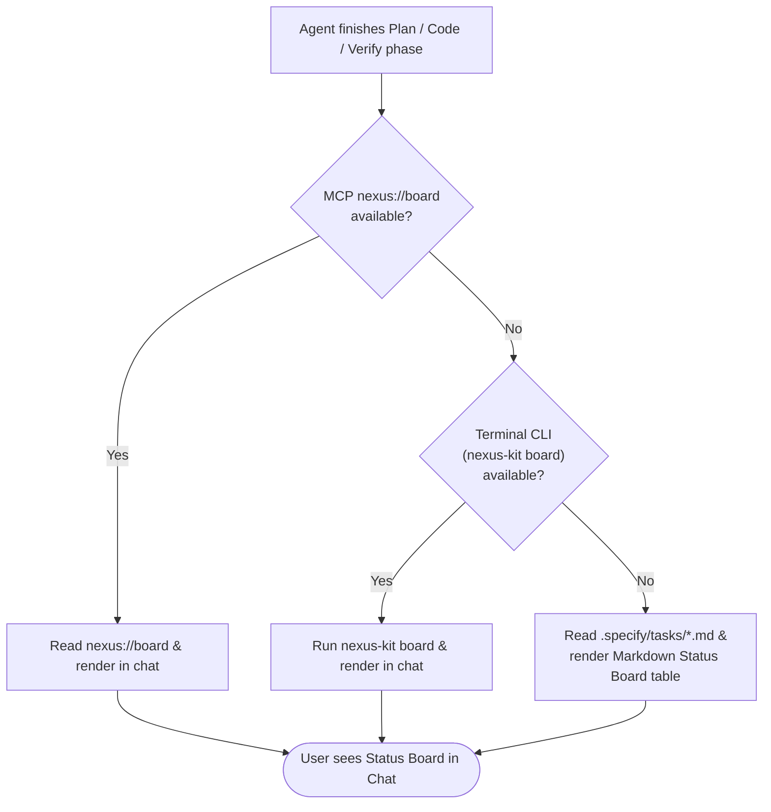

# SPEC-012: Auto Status Board in Chat Across All AI IDEs & Agents

> **Status:** `Completed`  
> **Version:** `1.0.0`  
> **Author:** `sdd-planner`  
> **Date:** 2026-11-18  
> **Approved-By:** `quyettranhuu`  
> **Approved-At:** `2026-11-18T16:05:49.247Z`  
> **Approved-Hash:** `sha256:20e154213fe3ff738f252113a328e33f82cedb4bdb8230dbe8c2f5ff1ff47cb5`  
> **Upstream Spec Kit:** Compatible with Spec Kit v1.0+  
> **Target Path:** `create-nexus-kit/lib/`, `create-nexus-kit/install.sh`, `create-nexus-kit/tests/`, `.agents/skills/`, `AGENTS.md`, `CLAUDE.md`, `.cursor/rules/nexus-kit.mdc`, `.github/copilot-instructions.md`, `.windsurfrules`, `.clinerules`

---

## 1. Overview & Objective

### 1.1 Problem Statement
Currently, AI agents using Nexus Kit do not consistently render the **Spec Status Board** in chat responses across different machines, IDEs, and models because:
1. None of the SDD skills (`sdd-planner`, `sdd-coder`, `sdd-verifier`) or IDE adapters (`AGENTS.md`, `CLAUDE.md`, `.cursor/rules/nexus-kit.mdc`, `.github/copilot-instructions.md`, `.windsurfrules`, `.clinerules`) explicitly instruct agents to display the Spec Status Board at the end of each phase.
2. Machines without MCP configured (`nexus://board`) or running in offline/sandboxed terminals (where `npx create-nexus-kit board` cannot run) have no deterministic fallback instruction to render a Markdown Status Board directly from `.specify/tasks/`.
3. MCP workflow prompts (`sdd_plan`, `sdd_implement`, `sdd_verify`) in `lib/mcp.js` do not include the final Status Board reporting step.

### 1.2 User Stories
- **As a Developer using any AI IDE** (Cursor, Claude Code, Antigravity, Windsurf, Cline, GitHub Copilot), I want the AI agent to automatically show the current **Spec Status Board** in chat at the end of Planning, Coding, and Verification phases so I always have immediate visibility into all specs, statuses, hashes, and AC progress.
- **As an Offline / Sandboxed Developer**, I want the AI agent to fall back gracefully to rendering a Markdown Status Board directly from `.specify/tasks/` when CLI execution or MCP is unavailable.

### 1.3 Scope Boundaries
- **In-Scope:**
  - Add an explicit **Status Board Reporting** directive to all 3 SDD skills (`sdd-planner`, `sdd-coder`, `sdd-verifier`) with deterministic 3-tier resolution:
    1. Prefer MCP resource `nexus://board` if connected.
    2. Otherwise run `npx create-nexus-kit board` (or `nexus-kit board`) in terminal and paste output in a fenced block.
    3. Offline/sandbox fallback: read `.specify/tasks/*-spec.md` and render a clean Markdown Status Board table (`ID | Ver | Status | Integrity | Criteria | Progress | Title`).
  - Add a concise **Status Board Visibility** rule to all 6 IDE adapters (`AGENTS.md`, `CLAUDE.md`, `.cursor/rules/nexus-kit.mdc`, `.github/copilot-instructions.md`, `.windsurfrules`, `.clinerules`).
  - Keep 100% template parity across `create-nexus-kit/lib/templates.js`, root repository files, and `create-nexus-kit/install.sh`.
  - Update MCP workflow prompts (`sdd_plan`, `sdd_implement`, `sdd_verify`) in `create-nexus-kit/lib/mcp.js` to include the Status Board reporting step.
  - Add automated tests in `create-nexus-kit/tests/` verifying that all skills, IDE adapters, MCP prompts, and `install.sh` include the Auto Status Board directive and maintain 100% parity.
  - Bump version to `2.2.0` in `create-nexus-kit/package.json` and `create-nexus-kit/lib/nexus.js`, and update `CHANGELOG.md`.
- **Out-of-Scope:**
  - Changing the ANSI rendering format of `renderTasksBoard()`.
  - Adding new CLI flags or breaking existing doctor checks.

---

## 2. Data Models & Interface Contracts

### 2.1 Three-Tier Status Board Resolution Contract
Every agent concluding a Planning, Coding, or Verification phase MUST follow this exact fallback chain:
1. **Tier 1 (MCP)**: Read resource `nexus://board` if the `nexus-kit` MCP server is available.
2. **Tier 2 (CLI)**: Run `nexus-kit board` or `npx create-nexus-kit board` and include the rendered board in the response.
3. **Tier 3 (Offline / Zero-Tool Fallback)**: Read `.specify/tasks/*-spec.md` directly and emit a Markdown table with columns:
   `| ID | Ver | Status | Integrity | Criteria | Progress | Title |`

### 2.2 Parity Contract
The following 9 pairs MUST remain byte-for-byte identical (after `\r\n` normalization):
- Root repo `.agents/skills/{sdd-planner,sdd-coder,sdd-verifier}/SKILL.md` ↔ `TEMPLATES.{plannerSkill,coderSkill,verifierSkill}` ↔ `install.sh`
- Root repo `AGENTS.md`, `CLAUDE.md`, `.cursor/rules/nexus-kit.mdc`, `.github/copilot-instructions.md`, `.windsurfrules`, `.clinerules` ↔ `TEMPLATES.{agents,claude,cursor,copilot,windsurf,cline}Adapter` ↔ `install.sh`

---

## 3. Logic Flow & State Transitions

---

## 4. Edge Cases & Error Handling

- [x] **No MCP server configured**: Agent smoothly falls back to CLI `nexus-kit board` or Markdown table without failing.
- [x] **Offline / sandboxed terminal (no `npx` network)**: Agent does not fail or hang; falls back to reading `.specify/tasks/` directly and rendering Markdown table.
- [x] **Empty `.specify/tasks/` directory**: Agent clearly reports `0 specs` and prompts user to run `sdd-planner`.
- [x] **Template Parity Drift**: `validateProject` (`--doctor`) verifies root repo templates remain 100% synced with `lib/templates.js`.

---

## 5. Acceptance Criteria

- [x] **AC-1 (SDD Skills Updated)**: `sdd-planner`, `sdd-coder`, and `sdd-verifier` `SKILL.md` templates and root files explicitly include the 3-tier Auto Status Board in Chat directive (`nexus://board` ➔ `nexus-kit board` ➔ Markdown fallback).
- [x] **AC-2 (All 6 IDE Adapters Updated)**: `AGENTS.md`, `CLAUDE.md`, `.cursor/rules/nexus-kit.mdc`, `.github/copilot-instructions.md`, `.windsurfrules`, and `.clinerules` include the Status Board reporting rule.
- [x] **AC-3 (MCP Prompts Updated)**: `sdd_plan`, `sdd_implement`, and `sdd_verify` prompts in `create-nexus-kit/lib/mcp.js` include the Status Board display instruction.
- [x] **AC-4 (`install.sh` & Root Repo Parity)**: `create-nexus-kit/install.sh` and root repo files match `create-nexus-kit/lib/templates.js` 100%, verified by `--doctor .` with 0 failures.
- [x] **AC-5 (Automated Tests & Version Bump)**: Regression tests verify the Status Board directive across skills, IDE adapters, MCP prompts, and `install.sh`; all tests pass and version is bumped to `2.2.0` with `CHANGELOG.md` updated.

---

## 6. Change Log

| Version | Date | Author | Summary |
| :--- | :--- | :--- | :--- |
| `1.0.0` | `2026-11-18` | `sdd-planner` | Initial specification for Auto Status Board in Chat across all AI IDEs & Agents (v2.2.0). |
