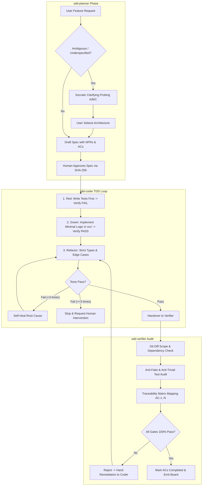

# SPEC-013: Agentic Skills Evolution: TDD Red-Green Loop, Socratic Probing, Anti-Fake Test Guardrails & NFR Schema

> **Status:** `Completed`  
> **Version:** `1.0.0`  
> **Author:** Antigravity AI  
> **Date:** 2026-11-22  
> **Approved-By:** `quyettranhuu`  
> **Approved-At:** `2026-11-22T06:49:42.006Z`  
> **Approved-Hash:** `sha256:a53bc5b5c9040f4ee572419019946c85d0468414f4be902e3f88be01ffb99816`  
> **Upstream Spec Kit:** Compatible with Spec Kit v1.0+  
> **Target Path:** `.agents/skills/sdd-planner/SKILL.md`, `.agents/skills/sdd-coder/SKILL.md`, `.agents/skills/sdd-verifier/SKILL.md`, `.specify/templates/spec-template.md`, `create-nexus-kit/lib/templates.js`, `create-nexus-kit/install.sh`, `create-nexus-kit/tests/skills.test.js`, `dist/agensi/nexus-kit/SKILL.md`

---

## 1. Overview & Objective

### 1.1 Problem Statement
Làn sóng AI Coding Agents hiện nay (Claude Code, SWE-bench top performers, OpenAI reasoning models, Google Antigravity) đang đặt ra các chuẩn mực khắt khe về kỹ thuật phần mềm tự chủ. 
Mặc dù Nexus Kit đã giải quyết bài toán chống "vibe coding" bằng SDD Triad và cryptographic approval hashes, bộ kỹ năng (`.agents/skills/`) hiện tại vẫn có những hạn chế kỹ thuật:
1. **`sdd-planner`**: Dễ sinh spec dài dựa trên các giả định ngầm của LLM mà không có quy trình hỏi sâu đa phương án (Socratic A/B/C probing); `spec-template.md` thiếu mục chuẩn hóa Non-Functional Requirements (NFRs: Latency budget, Security constraints, Backward compatibility).
2. **`sdd-coder`**: Quy trình hiện tại viết code nghiệp vụ trước rồi mới viết test sau. Điều này dẫn đến anti-pattern phổ biến của AI: viết test thiên kiến (biased tests) chỉ để chứng minh code vừa viết là đúng, thay vì kiểm chứng xem code có thỏa mãn đặc tả hay không. Ngoài ra còn thiếu quy tắc Bounded Self-Healing (tự phục hồi có giới hạn, tránh sửa bừa phá hỏng test).
3. **`sdd-verifier`**: Chưa có cơ chế rà soát Fake Tests (test rỗng, mock quá đà triệt tiêu logic thực, trivial assertion như `expect(true).toBe(true)`) và chưa rà soát rò rỉ phạm vi (Scope & Dependency Leak) thông qua Git diff.
4. **Scaffolding Parity**: `create-nexus-kit/lib/templates.js`, `create-nexus-kit/install.sh`, và `dist/agensi/nexus-kit/SKILL.md` cần đồng bộ 100% các tiêu chuẩn tiên tiến này.

### 1.2 User Stories
- **As a** Developer sử dụng Nexus Kit, **I want** các AI agent tuân thủ chu trình TDD Red-Green nghiêm ngặt và giải trình trung thực chất lượng test **so that** tôi hoàn toàn tin tưởng code được sinh ra không có lỗi ngầm, fake test hay rò rỉ scope.
- **As a** Software Architect, **I want** AI Planner phải hỏi rõ ràng các ràng buộc phi chức năng (NFRs) và phương án kiến trúc trước khi chốt spec **so that** kiến trúc hệ thống luôn chặt chẽ và không bị ảo giác kỹ thuật.

### 1.3 Scope Boundaries (Ranh giới phạm vi)
- **In-Scope (Đợt 1 - Cải tiến Bộ Kỹ năng & Template):**
  - Nâng cấp `sdd-planner/SKILL.md` với Socratic Probing & Pre-flight Codebase Inspection.
  - Nâng cấp `.specify/templates/spec-template.md` bổ sung mục `2.3 Non-Functional Requirements (NFRs)`.
  - Nâng cấp `sdd-coder/SKILL.md` với chu trình bắt buộc **TDD Red-Green-Refactor Loop** và **Bounded Self-Healing Loop** (tối đa 3 vòng lặp, cấm hạ chuẩn test).
  - Nâng cấp `sdd-verifier/SKILL.md` với **Anti-Fake Test Audit** và **Git Diff Scope & Dependency Leak Detection**.
  - Đồng bộ hóa 100% vào `create-nexus-kit/lib/templates.js`, `create-nexus-kit/install.sh`, và `dist/agensi/nexus-kit/SKILL.md`.
  - Xây dựng bộ test tự động `create-nexus-kit/tests/skills.test.js` kiểm tra tính toàn vẹn của các quy tắc mới.
- **Out-of-Scope (Dành cho Đợt 2 & Đợt 3 tiếp theo):**
  - Đợt 2: Subagent Handoff Protocol & Native MCP Sampling.
  - Đợt 3: GitHub Action `nexus-guard` PR Gate.

---

## 2. Data Models & Interface Contracts

### 2.1 Skill Enhancement Contracts

#### A. `sdd-planner` Contract Updates
- **Socratic Clarifying Probing Rule:**
  - Nếu yêu cầu người dùng thiếu thông số kỹ thuật (DB engine, Auth type, Error format, Framework version), AI KHÔNG được tự ý giả định.
  - Bắt buộc đưa ra câu hỏi ngắn gọn kèm các lựa chọn phương án:
    `[Option A: ...]`, `[Option B: ...]`, `[Option C: ...]` để người dùng chốt phương án.
- **Pre-flight Codebase Audit:**
  - Tra cứu các interface, helper, utils đã có trong repo để tái sử dụng, tránh duplicate.

#### B. `spec-template.md` Contract Updates
Bổ sung tiểu mục 2.3 vào cấu trúc đặc tả:
```markdown
### 2.3 Non-Functional Requirements (NFRs)
- **Performance Budget:** (vd: API response < 200ms, bundle size impact < 5KB).
- **Security & Privacy:** (vd: Input sanitization, Zero plain-text secrets, OWASP compliance).
- **Backward Compatibility & Migrations:** (vd: Breaking changes, deprecation notice, schema migration path).
```

#### C. `sdd-coder` Contract Updates
- **Mandatory TDD Red-Green-Refactor Loop:**
  1. **Red Phase (Test First):** Tạo file test trong thư mục tests. Viết test cases ánh xạ trực tiếp các `AC-1`..`AC-N`. Chạy test và ghi nhận kết quả **FAIL (Red)** với lý do hợp lệ.
  2. **Green Phase (Minimal Implementation):** Viết lượng code tối thiểu trong `src/` để thỏa mãn test. Chạy test và ghi nhận kết quả **PASS (Green)**.
  3. **Refactor Phase (Hardening):** Chuẩn hóa kiểu dữ liệu (no `any`), xử lý triệt để edge cases, tối ưu hóa code theo `constitution.md`.
- **Bounded Self-Healing Policy:**
  - Nếu test fail: đọc error stack trace, sửa đúng root cause.
  - Giới hạn: tối đa 3 lần lặp (max 3 self-heal cycles).
  - CẤM: Không được hạ thấp chuẩn test, không được comment out assertions, không đổi sang `expect(true).toBe(true)` để qua mặt test.

#### D. `sdd-verifier` Contract Updates
- **Anti-Trivial / Anti-Fake Test Audit:**
  - Quét test suites: cấm assertions sáo rỗng, cấm mock toàn bộ core logic đến mức test chạy qua mà không kiểm tra gì.
- **Git Diff Scope & Dependency Leak Detection:**
  - Chạy `git diff --name-only` hoặc kiểm tra danh sách file đã sửa: nếu có file nằm ngoài `Target Path` của spec -> Đánh cờ **FAILED [Scope Creep]**.
  - Kiểm tra `package.json`: nếu có dependencies mới không nằm trong `In-Scope` -> Đánh cờ **FAILED [Unauthorized Dependency]**.

---

## 3. Logic Flow & State Transitions



---

## 4. Edge Cases & Error Handling

- [x] **Underspecified User Prompts**: Planner không được tự ý suy đoán giải thuật; bắt buộc kích hoạt Socratic Probing.
- [x] **Self-Healing Loop Exhaustion**: Nếu Coder thử sửa 3 lần mà test vẫn fail, phải ngưng vòng lặp, giải trình rõ ràng lỗi và xin chỉ thị thay vì lặp vô tận.
- [x] **Subtle Test Tampering**: Verifier phát hiện ra Coder sửa đổi file test để loại bỏ assertion nhằm làm xanh test -> Verifier đánh trượt ngay lập tức.
- [x] **Scope Creep / Unsolicited Formatting**: File ngoài `Target Path` bị sửa do linter tự động -> Verifier cảnh báo và yêu cầu chỉ commit đúng file trong phạm vi spec.
- [x] **Offline / Sandboxed Environments**: Các quy tắc kiểm tra test và git diff phải hoạt động trơn tru trong sandbox lẫn unsandboxed.

---

## 5. Acceptance Criteria (Tiêu chí nghiệm thu)

- [x] **AC-1**: `sdd-planner/SKILL.md` và `plannerSkill` trong `templates.js` & `install.sh` chứa đầy đủ quy tắc Socratic Probing (phương án A/B/C) và Pre-flight Codebase Inspection.
- [x] **AC-2**: `.specify/templates/spec-template.md` và `specTemplate` trong `templates.js` & `install.sh` chứa mục chuẩn hóa `## 2.3 Non-Functional Requirements (NFRs)`.
- [x] **AC-3**: `sdd-coder/SKILL.md` và `coderSkill` trong `templates.js` & `install.sh` quy định bắt buộc chu trình TDD Red-Green-Refactor Loop và Bounded Self-Healing (tối đa 3 lần lặp, cấm hạ chuẩn test).
- [x] **AC-4**: `sdd-verifier/SKILL.md` và `verifierSkill` trong `templates.js` & `install.sh` bổ sung Anti-Fake Test Audit và Git Diff Scope & Dependency Leak Check.
- [x] **AC-5**: `dist/agensi/nexus-kit/SKILL.md` được cập nhật đồng bộ các nguyên tắc TDD Red-Green, NFRs và Anti-Fake test audit.
- [x] **AC-6**: Tạo test suite `create-nexus-kit/tests/skills.test.js`, toàn bộ 100% tests chạy qua không lỗi và `node create-nexus-kit/bin/index.js --doctor .` đạt 23/23 tiêu chí chuẩn mực.

---

## 6. Change Log

| Version | Date | Author | Summary |
| :--- | :--- | :--- | :--- |
| `1.0.0` | 2026-11-22 | Antigravity AI | Initial draft for Agentic Skills Evolution (SPEC-013). |
