# SPEC-014: Subagent Handoff Protocol & Native MCP Sampling Audit

> **Status:** `Completed`  
> **Version:** `1.0.0`  
> **Author:** `sdd-planner`  
> **Date:** 2026-11-23  
> **Approved-By:** `quyettranhuu`  
> **Approved-At:** `2026-11-23T05:00:25.971Z`  
> **Approved-Hash:** `sha256:76e54f14eacb9b1b30db4dc8a578c5600a77eca81ca6b8086ec0bc7150596d6b`  
> **Upstream Spec Kit:** Compatible with Spec Kit v1.0+  
> **Target Path:** `.agents/skills/sdd-planner/SKILL.md`, `.agents/skills/sdd-coder/SKILL.md`, `.agents/skills/sdd-verifier/SKILL.md`, `AGENTS.md`, `CLAUDE.md`, `.cursor/rules/nexus-kit.mdc`, `.github/copilot-instructions.md`, `.windsurfrules`, `.clinerules`, `create-nexus-kit/lib/mcp.js`, `create-nexus-kit/lib/templates.js`, `create-nexus-kit/install.sh`, `dist/agensi/nexus-kit/SKILL.md`, `create-nexus-kit/tests/mcp-sampling.test.js`

---

## 1. Overview & Objective

### 1.1 Problem Statement
Sau khi hoàn thành Đợt 1 (SPEC-013) nâng cấp chu trình TDD Red-Green và Socratic Probing, hệ sinh thái Nexus Kit cần giải quyết 2 bài toán then chốt tiếp theo về kiến trúc đa tác tử (Multi-Agent Architecture) và kiểm toán tự động:
1. **Sự gián đoạn trong chuyển giao tác tử (Manual Handoff Friction)**: Hiện tại, luồng chuyển dịch giữa `planner` $\rightarrow$ `coder` $\rightarrow$ `verifier` hoàn toàn phụ thuộc vào việc người dùng nhớ và gõ các slash command thủ công. Trong các IDE/harness hỗ trợ đa tác tử (Google Antigravity, Claude Code, Cursor, Cline, OpenAI Swarm), các agent cần có một giao thức chuẩn hóa (Agent Handoff Protocol) để tự động kích hoạt hoặc phân rã công việc cho subagents chuyên trách.
2. **Thiếu năng lực đánh giá ngữ nghĩa trong MCP Server**: Máy chủ MCP của Nexus Kit hiện chỉ hỗ trợ các tools tĩnh (`nexus_verify_spec`, `nexus_doctor`, v.v.). Giao thức MCP (2024-11-05+) hỗ trợ tính năng **MCP Sampling (`sampling/createMessage`)**, cho phép server gửi request ngược lại cho AI host để thực hiện đánh giá ngữ nghĩa (Adversarial Semantic Audit) mà không cần hardcode bất kỳ API key của bên thứ ba nào.

### 1.2 User Stories
- **As a** Developer sử dụng Nexus Kit trong các IDE đa tác tử, **I want** các agent tự động đề xuất hoặc kích hoạt chuyển giao nhiệm vụ và spawn subagents chuyên trách **so that** quy trình SDD diễn ra liền mạch, không bị gián đoạn context.
- **As a** Software Architect, **I want** máy chủ MCP sở hữu tool `nexus_audit_compliance` kết hợp giữa phân tích tĩnh (Static Hash/Scope/Test Heuristics) và MCP Sampling **so that** mọi mã nguồn trước khi release đều được kiểm toán hai tầng (máy móc và ngữ nghĩa) một cách tự động.

### 1.3 Scope Boundaries (Ranh giới phạm vi)
- **In-Scope (Đợt 2 - SPEC-014):**
  - **Subagent Handoff Protocol**:
    - Bổ sung chỉ dẫn chuẩn hóa `## Agent Handoff Protocol` vào cả 3 skills (`sdd-planner`, `sdd-coder`, `sdd-verifier`).
    - Đồng bộ hóa vào toàn bộ 6 IDE Adapters (`AGENTS.md`, `CLAUDE.md`, `.cursor/rules/nexus-kit.mdc`, `.github/copilot-instructions.md`, `.windsurfrules`, `.clinerules`), `lib/templates.js`, `install.sh`, `dist/agensi/nexus-kit/SKILL.md`.
  - **MCP Sampling & Compliance Audit Tool (`nexus_audit_compliance`)**:
    - Nâng cấp `create-nexus-kit/lib/mcp.js` lưu trữ `clientCapabilities` trong bước handshake `initialize`.
    - Hỗ trợ cơ chế gửi request ngược từ Server sang Client theo JSON-RPC 2.0 (`sampling/createMessage`) với timeout an toàn.
    - Xây dựng tool MCP mới `nexus_audit_compliance`: kiểm tra Static Hash Integrity, rà soát Scope Git Diff, phân tích Test Quality Heuristics, và kích hoạt Sampling Audit nếu client hỗ trợ (fallback an toàn nếu offline/không hỗ trợ).
  - **Automated Regression Tests**:
    - Xây dựng test suite `create-nexus-kit/tests/mcp-sampling.test.js` kiểm chứng tool registration, static audit, sampling request handling, và template parity.
- **Out-of-Scope (Dành cho Đợt 3):**
  - Xây dựng GitHub Action PR bot `nexus-guard`.

---

## 2. Data Models & Interface Contracts

### 2.1 Domain Models (TypeScript / Schemas)

```typescript
export interface McpAuditResult {
  specId: string;
  specPath: string;
  overallStatus: 'PASSED' | 'FAILED' | 'WARNING';
  integrity: {
    status: string;
    approvedHash: string;
    liveHash: string;
    valid: boolean;
  };
  scope: {
    targetPaths: string[];
    changedFiles: string[];
    leaksDetected: string[];
    valid: boolean;
  };
  testQuality: {
    testFilesFound: string[];
    emptyTestsDetected: string[];
    trivialAssertionsDetected: string[];
    valid: boolean;
  };
  samplingAudit?: {
    performed: boolean;
    verdict?: 'APPROVE' | 'REJECT' | 'NEEDS_WORK';
    feedback?: string;
    reason?: string;
  };
}
```

### 2.2 MCP Tool Contract (`nexus_audit_compliance`)
- **Tool Name:** `nexus_audit_compliance`
- **Description:** Run comprehensive compliance audit on an approved spec against current git workspace, validating cryptographic hash integrity, git diff scope leaks, anti-fake test heuristics, and triggering MCP sampling for adversarial semantic review when supported.
- **Input Schema:**
```json
{
  "type": "object",
  "properties": {
    "specPath": {
      "type": "string",
      "description": "Path to the target specification (e.g. .specify/tasks/013-agentic-skills-evolution-spec.md)"
    },
    "targetDir": {
      "type": "string",
      "description": "Target project root directory (defaults to cwd)."
    },
    "enableSampling": {
      "type": "boolean",
      "description": "Whether to request MCP sampling from the host AI (default: true)."
    }
  },
  "required": ["specPath"]
}
```

### 2.3 Non-Functional Requirements (NFRs)
- **Performance Budget:** Static analysis (hash, scope diff, test scan) phải hoàn tất trong < 150ms; nếu gọi sampling, timeout tối đa 20s và tự động fallback về static result nếu client không phản hồi.
- **Security & Privacy:** Không gửi nội dung các file bí mật (`.env`, `id_rsa`) hay file nằm ngoài `Target Path` qua request sampling; sanitize thông tin đầu vào.
- **Backward Compatibility:** Giữ tương thích 100% với các MCP clients không hỗ trợ sampling (Cursor, Claude Desktop cũ). Server không được văng lỗi unhandled exception.

---

## 3. Logic Flow & State Transitions

```mermaid
flowchart TD
    subgraph MultiAgentHandoff [Agent Handoff Protocol]
        Planner[sdd-planner] -->|Spec Approved| HandoffPrompt1[Emit /sdd-coder Command & Board]
        HandoffPrompt1 --> Coder[sdd-coder]
        Coder -->|TDD Tests Green| HandoffPrompt2[Emit /sdd-verifier Command & Board]
        HandoffPrompt2 --> Verifier[sdd-verifier]
        Verifier -->|All ACs Pass| Closed[Mark Completed & Emit Final Board]
        Verifier -->|ACs Fail| Remediate[Return Failure Log to sdd-coder]
        Remediate --> Coder
    end

    subgraph MCPAudit [nexus_audit_compliance Tool Execution]
        CallTool[tools/call: nexus_audit_compliance] --> CheckHash[1. Verify Spec Hash & Target Path]
        CheckHash --> CheckDiff[2. Git Diff Scope & Dependency Leak Scan]
        CheckDiff --> CheckTests[3. Anti-Fake Test Heuristics Scan]
        CheckTests --> HasSampling{Client supports\nsampling?}
        HasSampling -- Yes --> SendSample[Send JSON-RPC sampling/createMessage]
        SendSample --> WaitResponse{Sampling Response\nwithin 20s?}
        WaitResponse -- Yes --> Combine[Combine Static & Sampling Findings]
        WaitResponse -- No/Timeout --> FallbackStatic[Fallback to Static Results with reason]
        HasSampling -- No --> FallbackStatic
        FallbackStatic --> ReturnResult[Return McpAuditResult JSON]
        Combine --> ReturnResult
    end
```



---

## 4. Edge Cases & Error Handling

- [x] **Client Lacks Sampling Capability**: Host IDE (như các bản MCP cũ) không khai báo `capabilities.sampling` $\rightarrow$ Server tự động thực hiện Static Audit và ghi chú `samplingAudit: { performed: false, reason: "Client does not support sampling" }`.
- [x] **Sampling Request Timeout / Refusal**: Host IDE từ chối cấp quyền sampling hoặc timeout sau 20s $\rightarrow$ Server ghi nhận kết quả static mà không làm gián đoạn tool call.
- [x] **Spec File Outside `.specify/tasks/`**: Tool từ chối thực thi với thông báo lỗi rõ ràng.
- [x] **Non-git Directory**: Trả về cảnh báo scope check bị bỏ qua do không phát hiện repository git.
- [x] **Untracked or Leaked Files**: Báo cáo chi tiết danh sách file vi phạm ranh giới `Target Path`.

---

## 5. Acceptance Criteria (Tiêu chí nghiệm thu)

- [x] **AC-1**: Cả 3 skills (`sdd-planner`, `sdd-coder`, `sdd-verifier`) và 6 IDE adapters (`AGENTS.md`, `CLAUDE.md`, `.cursor/rules/nexus-kit.mdc`, `.github/copilot-instructions.md`, `.windsurfrules`, `.clinerules`) được cập nhật mục `## Agent Handoff Protocol` với cú pháp trigger chuyển giao rõ ràng.
- [x] **AC-2**: `create-nexus-kit/lib/mcp.js` lưu trữ `clientCapabilities` trong bước handshake `initialize` và cung cấp cơ chế gửi JSON-RPC request ngược chiều (`sampling/createMessage`) với timeout an toàn.
- [x] **AC-3**: Tool `nexus_audit_compliance` được đăng ký vào `MCP_TOOLS` và triển khai đầy đủ 3 tầng phân tích tĩnh: Static Spec Hash, Git Diff Scope Leaks, và Anti-Fake Test Heuristics.
- [x] **AC-4**: `nexus_audit_compliance` tích hợp gọi `sampling/createMessage` khi client hỗ trợ sampling và fallback an toàn khi sampling bị từ chối hoặc timeout.
- [x] **AC-5**: Toàn bộ thay đổi được đồng bộ 100% vào `create-nexus-kit/lib/templates.js`, `create-nexus-kit/install.sh`, và `dist/agensi/nexus-kit/SKILL.md`.
- [x] **AC-6**: Tạo test suite `create-nexus-kit/tests/mcp-sampling.test.js` kiểm chứng đầy đủ các tiêu chí trên; 100% test suites trong dự án pass và `node create-nexus-kit/bin/index.js --doctor .` đạt chuẩn 24/24.

---

## 6. Change Log

| Version | Date | Author | Summary |
| :--- | :--- | :--- | :--- |
| `1.0.0` | 2026-11-23 | `sdd-planner` | Initial specification for Subagent Handoff Protocol & Native MCP Sampling Audit (SPEC-014). |
