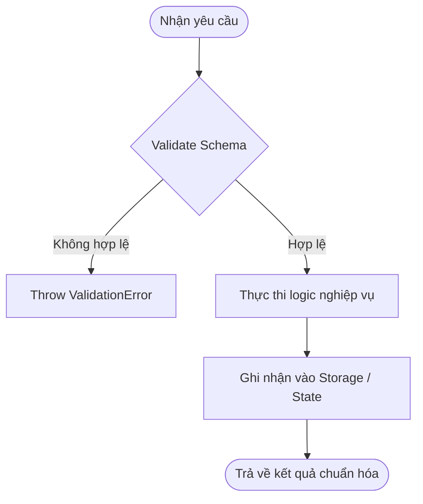

# [SPEC-ID]: [Feature Title]

> **Status:** `Draft` | `In Review` | `Approved` | `In Progress` | `Completed`  
> **Author:** [AI Agent / Engineer]  
> **Date:** [YYYY-MM-DD]  
> **Upstream Spec Kit:** Compatible with Spec Kit v1.0+  
> **Target Path:** `src/...`

---

## 1. Overview & Objective

### 1.1 Problem Statement
*Mô tả ngắn gọn bối cảnh và vấn đề thực tế cần giải quyết.*

### 1.2 User Stories
- **As a** `[vai trò người dùng]`, **I want** `[hành động / chức năng]` **so that** `[giá trị mang lại]`.
- **As a** `[vai trò người dùng]`, **I want** `[hành động / chức năng]` **so that** `[giá trị mang lại]`.

### 1.3 Scope Boundaries (Ranh giới phạm vi)
- **In-Scope (Bắt buộc làm):**
  - [Liệt kê các module / chức năng cần xây dựng]
- **Out-of-Scope (Tuyệt đối không làm trong task này):**
  - [Liệt kê các chức năng chưa cần thiết để ngăn chặn AI Vibe Coding]

---

## 2. Data Models & Interface Contracts

### 2.1 Domain Models (TypeScript / Schemas)
```typescript
export interface EntityModel {
  id: string;          // UUID v4
  title: string;       // Non-empty string
  createdAt: string;   // ISO 8601 UTC
}
```

### 2.2 API / CLI / Component Contracts
- **Input / Signature:**
- **Output / Return Type:**
- **Failure Responses:**

---

## 3. Logic Flow & State Transitions



---

## 4. Edge Cases & Error Handling

- [ ] **Empty / Null Input**: Xử lý đầu vào rỗng.
- [ ] **Timeout / Network Failure**: Xử lý lỗi kết nối hoặc gián đoạn.
- [ ] **Duplicate / Idempotency**: Xử lý trường hợp thao tác lặp lại.

---

## 5. Acceptance Criteria (Tiêu chí nghiệm thu)

*Mọi code được sinh ra phải vượt qua 100% các tiêu chí dưới đây:*

- [ ] **AC-1**: Dữ liệu đầu vào bắt buộc được validate qua schema tường minh.
- [ ] **AC-2**: Thực thi đúng luồng xử lý và trả về đúng hợp đồng đã cam kết.
- [ ] **AC-3**: Xử lý đầy đủ các trường hợp biên tại mục 4.
- [ ] **AC-4**: Không sử dụng `any`, tuân thủ 100% `constitution.md`.
- [ ] **AC-5**: Có unit test bao phủ luồng chính và ít nhất 2 trường hợp lỗi biên.
