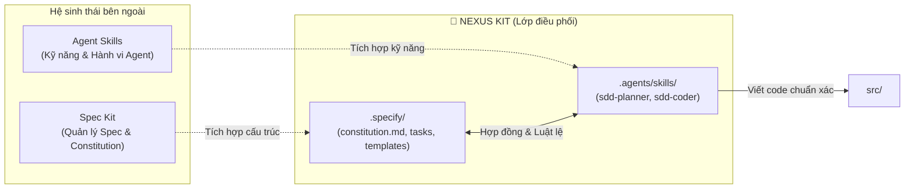

# Nexus Kit 🌌

**The Ultimate Integration Framework for Spec Kit & Agent Skills**

Nexus Kit là lớp điều phối và tích hợp tối ưu (Orchestration Layer) kết nối giữa **Spec Kit** (hệ thống quản trị đặc tả) và **Agent Skills** (hệ sinh thái kỹ năng của AI Agent). Cấu trúc này thiết lập một môi trường làm việc kỷ luật, đảm bảo AI Agents luôn vận hành có quy trình, loại bỏ hoàn toàn tình trạng "Vibe Coding".

---

## 🔗 Điều kiện tiên quyết (Prerequisites)

Để phát huy tối đa sức mạnh của Nexus Kit, môi trường phát triển của bạn nên có sẵn:

1. **[Spec Kit](https://github.com/github/spec-kit)**: Công cụ và tiêu chuẩn quản lý vòng đời đặc tả (Specification Lifecycle).
2. **[Agent Skills](https://github.com/anthropics/agent-skills)**: Tiêu chuẩn và kho kỹ năng định hướng hành vi cho AI Agent.

---

## ⚙️ Nexus Kit kết hợp 2 hệ sinh thái như thế nào?



- **`.specify/` (Kế thừa Spec Kit)**: Nơi chứa bộ luật (`constitution.md`) và các bản thiết kế tính năng (`tasks/`). Đây là "nguồn chân lý duy nhất" (Source of Truth) cho toàn bộ dự án.
- **`.agents/skills/` (Chuẩn Agent Skills)**: Chứa 2 kỹ năng chuyên biệt do Nexus Kit cung cấp để làm cầu nối:
  - **`sdd-planner`**: Dạy AI cách tuân thủ luật trong `constitution.md` và tạo ra các bản task spec chuẩn mực trong `.specify/tasks/`.
  - **`sdd-coder`**: Dạy AI cách đọc spec từ `.specify/tasks/` và phối hợp với các kỹ năng coding khác để hiện thực hóa vào `src/`.
- **`src/`**: Mã nguồn sản phẩm, được sinh ra hoàn toàn tất định và bám sát spec.

---

## 🚀 Khởi tạo nhanh với CLI

Bạn có thể nhanh chóng khởi tạo một dự án mới theo chuẩn Nexus Kit bằng công cụ dòng lệnh:

```bash
# Cách 1: Sử dụng npx (khuyên dùng)
npx create-nexus-kit my-project

# Cách 2: Sử dụng Curl (không cần cài trước Node.js)
curl -sL https://raw.githubusercontent.com/TranHuuQuyet/nexus-kit/main/create-nexus-kit/install.sh | bash
```

## Kiến trúc thư mục
- **`.specify/`**: Nơi chứa bộ luật (`constitution.md`) và các bản thiết kế tính năng (`tasks/`). Đây là "pháp luật" của dự án.
- **`.agents/skills/`**: Nơi chứa các kỹ năng (Skills) định hướng hành vi cho AI. Đây là "bộ não quy trình" giúp AI biết cách đọc luật và viết code đúng chuẩn.
- **`src/`**: Nơi chứa mã nguồn thực tế.

## Cách sử dụng cho Agent
1. Gọi Agent và yêu cầu lập kế hoạch tính năng (Agent sẽ dùng `sdd-planner` skill).
2. Duyệt bản spec được tạo trong `.specify/tasks/`.
3. Yêu cầu Agent tiến hành code (Agent sẽ dùng `sdd-coder` skill).
