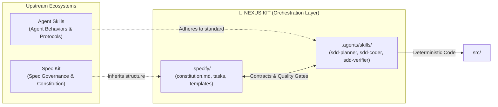

# Nexus Kit 🌌

<p align="center">
  <b>English</b> | <a href="README.vi.md"><b>Tiếng Việt</b></a>
</p>

[](https://www.npmjs.com/package/create-nexus-kit)
[](LICENSE)
[](https://github.com/TranHuuQuyet/nexus-kit/actions)
[](package.json)

---

**The Ultimate Integration Framework for Spec Kit & Agent Skills**

Nexus Kit is the premier orchestration layer seamlessly connecting **Spec Kit** (specification governance) and **Agent Skills** (agent execution standards). It establishes a disciplined, deterministic engineering environment that eliminates AI "vibe coding".

---

## 🔗 Prerequisites

To unlock the full potential of Nexus Kit, your development environment should have:

1. **[Spec Kit](https://github.com/github/spec-kit)**: Upstream tooling and standards for specification lifecycle management.
2. **[Agent Skills](https://github.com/anthropics/agent-skills)**: Open industry standard for AI agent behaviors and skills (`SKILL.md`).

---

## ⚙️ How Nexus Kit Bridges the Two Ecosystems



- **`.specify/` (Inheriting Spec Kit)**: Contains the project constitution (`constitution.md`), reusable templates (`templates/`), and active task specifications (`tasks/`). This serves as the single source of truth.
- **`.agents/skills/` (Adhering to Agent Skills Standard)**: Supplies the specialized SDD Triad bridging the two worlds:
  - **`sdd-planner`**: Teaches AI agents to consult `constitution.md` and draft structured specs into `.specify/tasks/`.
  - **`sdd-coder`**: Teaches AI agents to strictly implement approved task specs into `src/` with zero scope creep.
  - **`sdd-verifier`**: Automatically audits code against all Acceptance Criteria (ACs) defined in the task spec.
- **`src/`**: Application source code, created deterministically and traced directly to approved specs.

---

## 🚀 Quick Start with CLI

You can scaffold a new Nexus Kit project in seconds using the official zero-dependency CLI:

```bash
# Method 1: Using npx (Recommended)
npx create-nexus-kit my-project

# Method 2: Using Curl (No Node.js pre-install needed)
curl -sL https://raw.githubusercontent.com/TranHuuQuyet/nexus-kit/main/create-nexus-kit/install.sh | bash
```

---

## 📁 Directory Architecture

```text
nexus-kit/
├── .specify/                         # Spec Kit Domain
│   ├── constitution.md               # Supreme project guidelines & tech constraints
│   ├── templates/                    # Specification templates
│   │   └── spec-template.md
│   └── tasks/                        # Active feature specifications
├── .agents/skills/                   # Agent Skills Domain
│   ├── sdd-planner/SKILL.md          # Skill: Plan architecture & author specs
│   ├── sdd-coder/SKILL.md            # Skill: Write deterministic, type-safe code
│   └── sdd-verifier/SKILL.md         # Skill: Audit code vs Acceptance Criteria
├── src/                              # Production source code
├── create-nexus-kit/                 # Scaffolding CLI package (NPM)
├── README.md                         # English Documentation
├── README.vi.md                      # Vietnamese Documentation
├── CONTRIBUTING.md                   # Open source contribution guide
└── LICENSE                           # MIT License
```

---

## 🤖 The SDD Agent Protocol

```
User Request ➔ sdd-planner (Draft Spec) ➔ Human Approval Gate ➔ sdd-coder (Implement) ➔ sdd-verifier (Audit)
```

1. **Planning Phase**: Ask the AI Agent to design a feature. The agent triggers `sdd-planner`, loads `spec-template.md`, and writes a task spec to `.specify/tasks/`.
2. **Human Approval Gate**: Review and approve the specification document before any code is generated.
3. **Implementation Phase**: Instruct the agent to build the approved spec. The agent activates `sdd-coder`, creating modular, typed code in `src/`.
4. **Verification Phase**: The agent activates `sdd-verifier` to perform an audit verifying that all Acceptance Criteria are 100% satisfied.

---

## 📜 License, Legal & AI Governance

### 1. License
This project is open-source and licensed under the **[MIT License](LICENSE)** © 2026 [Tran Huu Quyet](https://github.com/TranHuuQuyet). You are free to use, modify, distribute, and commercialize this software.

### 2. Attribution & Upstream Paradigms
Nexus Kit is an independent open-source project designed to bridge open specifications:
- **[Spec Kit](https://github.com/github/spec-kit)**: Specification-Driven Development framework and conventions.
- **[Agent Skills Standard](https://github.com/anthropics/agent-skills)**: Open standard for AI agent capability specifications (`SKILL.md`).

### 3. AI Governance Disclaimer
This software, templates, and agent instructions are provided **"AS IS"**, without warranty of any kind. Users and organizations are responsible for reviewing, testing, and verifying all AI-generated code before deployment to production environments. The authors accept no liability for any unintended behavior or damages arising from AI-generated artifacts.
