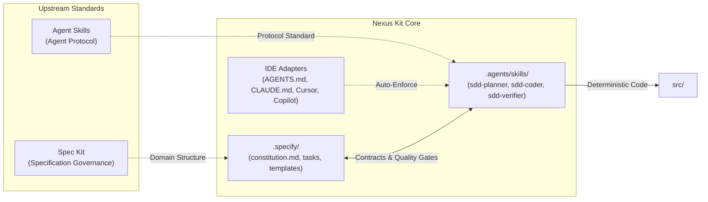

# Nexus Kit

<p align="center">
  <b>English</b> | <a href="README.vi.md"><b>Tiếng Việt</b></a>
</p>

<p align="center">
  <a href="https://www.npmjs.com/package/create-nexus-kit"></a>
  <a href="LICENSE"></a>
  <a href="https://github.com/TranHuuQuyet/nexus-kit/actions"></a>
  <a href="create-nexus-kit/package.json"></a>
</p>

---

## Overview

Nexus Kit is an orchestration framework that bridges **Spec Kit** (specification governance) and **Agent Skills** (agent execution standards). It establishes a disciplined, deterministic engineering environment designed to eliminate unstructured AI code generation ("vibe coding") across all major AI IDEs.

---

## Prerequisites

Nexus Kit integrates with two upstream open specifications:

1. **[Spec Kit](https://github.com/github/spec-kit)**: Tooling and standards for specification lifecycle management.
2. **[Agent Skills](https://github.com/anthropics/agent-skills)**: Open industry standard for defining AI agent capabilities (`SKILL.md`).

---

## Architecture



### Component Roles

- **`.specify/` (Spec Kit Domain)**: Houses the project constitution (`constitution.md`), reusable templates (`templates/`), and active task specifications (`tasks/`). Serves as the single source of truth.
- **`.agents/skills/` (Agent Skills Domain)**: Implements the production-grade SDD triad:
  - **`sdd-planner`**: Conducts clarifying interviews, enforces scope lock, and authors formal specifications into `.specify/tasks/`.
  - **`sdd-coder`**: Implements approved specifications in `src/` with strict typing, zero scope creep, and automated tests.
  - **`sdd-verifier`**: Performs zero-trust audits building a traceability matrix against all Acceptance Criteria.
- **IDE Adapters & Verified Discovery**: Explicit, verified rule files for each supported agent runtime:
  - **Antigravity / Open Standard**: Unconditionally loads `AGENTS.md` (directory-based rule without frontmatter) and progressively discovers `.agents/skills/*/SKILL.md`.
  - **Claude Code**: Automatically loads `CLAUDE.md` at repository root.
  - **Cursor**: Automatically enforces `.cursor/rules/nexus-kit.mdc` via `alwaysApply: true`.
  - **GitHub Copilot**: Automatically loads `.github/copilot-instructions.md`.
- **`src/`**: Application source code generated strictly from approved specifications.

---

## Supported IDEs

| IDE / Agent | Rule Discovery Mechanism | Skills Discovery | Status |
| :--- | :--- | :--- | :--- |
| **Antigravity** | `AGENTS.md` (unconditional directory rule) | `.agents/skills/*/SKILL.md` | Verified |
| **Claude Code** | `CLAUDE.md` (workspace root) | `.agents/skills/*/SKILL.md` | Verified |
| **Cursor** | `.cursor/rules/nexus-kit.mdc` (`alwaysApply: true`) | `.agents/skills/*/SKILL.md` | Verified |
| **GitHub Copilot** | `.github/copilot-instructions.md` | `.agents/skills/*/SKILL.md` | Verified |

---

## Quick Start

Initialize a new project safely using the zero-dependency CLI (existing files are skipped by default to protect user configurations):

```bash
# Method 1: Using npx (Recommended)
npx create-nexus-kit my-project

# Scaffold safely into an existing project (skips existing files)
npx create-nexus-kit .

# Overwrite existing files intentionally
npx create-nexus-kit . --force

# Method 2: Using Shell Script
curl -sL https://raw.githubusercontent.com/TranHuuQuyet/nexus-kit/main/create-nexus-kit/install.sh | bash

# Run deep YAML, structure, and cross-reference validation
npx create-nexus-kit --doctor
```

---

## Repository Structure

```text
nexus-kit/
├── .specify/                         # Spec Kit Domain
│   ├── constitution.md               # Engineering guidelines & constraints
│   ├── templates/                    # Specification templates
│   │   └── spec-template.md
│   └── tasks/                        # Feature specifications
├── .agents/skills/                   # Agent Skills Domain
│   ├── sdd-planner/SKILL.md          # Requirements elicitation & specification
│   ├── sdd-coder/SKILL.md            # Deterministic implementation
│   └── sdd-verifier/SKILL.md         # Specification compliance audit
├── .cursor/rules/nexus-kit.mdc       # Cursor IDE automatic rule enforcement
├── .github/copilot-instructions.md   # GitHub Copilot instructions
├── AGENTS.md                         # Antigravity / Open Standard directory rule
├── CLAUDE.md                         # Claude Code automatic instructions
├── src/                              # Application source code
├── create-nexus-kit/                 # Scaffolding CLI package (npm)
├── .github/workflows/ci.yml          # Automated CI pipeline
├── CONTRIBUTING.md                   # Contribution guidelines
├── README.md                         # English documentation
├── README.vi.md                      # Vietnamese documentation
└── LICENSE                           # MIT License
```

---

## Agent Protocol

```
Request ➔ sdd-planner (Draft Spec) ➔ Human Review Gate ➔ sdd-coder (Implement) ➔ sdd-verifier (Audit)
```

1. **Planning**: Prompt the agent to design a feature. The agent activates `sdd-planner`, loads `spec-template.md`, asks clarifying questions, and drafts a specification in `.specify/tasks/`.
2. **Review Gate**: Review and approve the specification document prior to code generation.
3. **Implementation**: Direct the agent to implement the approved spec. The agent activates `sdd-coder`, producing typed, modular code and tests in `src/`.
4. **Verification**: The agent activates `sdd-verifier` to audit all Acceptance Criteria before completion.

---

## License & Governance

### License
This project is open-source under the [MIT License](LICENSE) © 2026 [Tran Huu Quyet](https://github.com/TranHuuQuyet).

### Upstream Attribution
Nexus Kit is an independent project that builds on open specifications:
- **[Spec Kit](https://github.com/github/spec-kit)**: Specification-driven development conventions.
- **[Agent Skills](https://github.com/anthropics/agent-skills)**: Agent skill format and runtime specifications.

### Disclaimer
This software, accompanying templates, and agent instructions are provided "AS IS", without warranty of any kind. Users are responsible for evaluating, testing, and approving all AI-generated code prior to production deployment.
