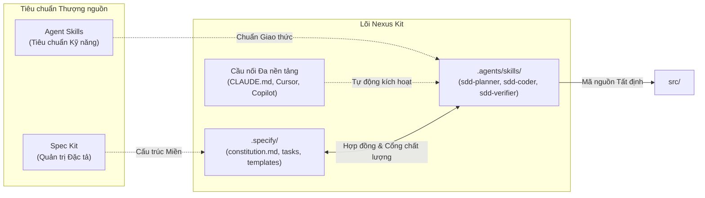

# Nexus Kit

<p align="center">
  <a href="README.md"><b>English</b></a> | <b>Tiếng Việt</b>
</p>

<p align="center">
  <a href="https://www.npmjs.com/package/create-nexus-kit"></a>
  <a href="LICENSE"></a>
  <a href="https://github.com/TranHuuQuyet/nexus-kit/actions"></a>
  <a href="create-nexus-kit/package.json"></a>
</p>

---

## Tổng quan

Nexus Kit là khung điều phối tích hợp giữa **Spec Kit** (quản trị đặc tả) và **Agent Skills** (tiêu chuẩn kỹ năng cho AI Agent). Cấu trúc này thiết lập một môi trường kỹ thuật kỷ luật, tất định, nhằm loại bỏ hoàn toàn tình trạng lập trình theo cảm tính (Vibe Coding) trên tất cả các AI IDE phổ biến.

---

## Điều kiện tiên quyết

Nexus Kit kết nối hai tiêu chuẩn mở thượng nguồn:

1. **[Spec Kit](https://github.com/github/spec-kit)**: Công cụ và tiêu chuẩn quản lý vòng đời đặc tả (Specification Lifecycle).
2. **[Agent Skills](https://github.com/anthropics/agent-skills)**: Tiêu chuẩn công nghiệp mở định nghĩa hành vi và kỹ năng cho AI Agent (`SKILL.md`).

---

## Kiến trúc hệ thống



### Vai trò các thành phần

- **`.specify/` (Miền Spec Kit)**: Chứa bản quy chuẩn kỹ thuật (`constitution.md`), các mẫu đặc tả (`templates/`) và các bản thiết kế tính năng (`tasks/`). Đây là nguồn chân lý duy nhất (Single Source of Truth).
- **`.agents/skills/` (Miền Agent Skills)**: Hiện thực hóa bộ ba kỹ năng SDD chuẩn công nghiệp:
  - **`sdd-planner`**: Phỏng vấn làm rõ yêu cầu, khóa phạm vi (Scope Lock) và khởi tạo đặc tả kỹ thuật chuẩn hóa trong `.specify/tasks/`.
  - **`sdd-coder`**: Lập trình mã nguồn trong `src/` với kiểu dữ liệu chặt chẽ, viết test tự động và bám sát phạm vi bản spec.
  - **`sdd-verifier`**: Thực hiện kiểm toán không khoan nhượng (Zero-Trust Audit), lập bảng truy vết đối chiếu từng tiêu chí nghiệm thu (`AC`).
- **Cầu nối Đa nền tảng (Multi-IDE Adapters)**: Các tệp cấu hình nhẹ (`CLAUDE.md`, `.cursor/rules/nexus-kit.mdc`, `.github/copilot-instructions.md`) giúp Claude Code, Cursor, GitHub Copilot và Antigravity tự động nhận diện và tuân thủ luật Nexus Kit ngay lập tức.
- **`src/`**: Mã nguồn sản phẩm, được sinh ra có kiểm soát và truy vết trực tiếp tới spec đã duyệt.

---

## Khởi tạo dự án

Khởi tạo một dự án mới bằng công cụ CLI không phụ thuộc thư viện ngoài (Zero-dependency):

```bash
# Cách 1: Sử dụng npx (Khuyên dùng)
npx create-nexus-kit my-project

# Cách 2: Sử dụng Shell Script
curl -sL https://raw.githubusercontent.com/TranHuuQuyet/nexus-kit/main/create-nexus-kit/install.sh | bash

# Kiểm tra sức khỏe cấu hình dự án hiện tại
npx create-nexus-kit --doctor
```

---

## Cấu trúc thư mục

```text
nexus-kit/
├── .specify/                         # Miền Spec Kit
│   ├── constitution.md               # Quy chuẩn kỹ thuật & công nghệ
│   ├── templates/                    # Mẫu đặc tả kỹ thuật
│   │   └── spec-template.md
│   └── tasks/                        # Các bản đặc tả tính năng
├── .agents/skills/                   # Miền Agent Skills
│   ├── sdd-planner/SKILL.md          # Lập kế hoạch kiến trúc & đặc tả
│   ├── sdd-coder/SKILL.md            # Triển khai mã nguồn tất định
│   └── sdd-verifier/SKILL.md         # Kiểm toán đối chiếu tiêu chí spec
├── .cursor/rules/nexus-kit.mdc       # Quy tắc tự động cho Cursor IDE
├── .github/copilot-instructions.md   # Quy tắc tự động cho GitHub Copilot
├── CLAUDE.md                         # Quy tắc tự động cho Claude Code
├── src/                              # Mã nguồn ứng dụng
├── create-nexus-kit/                 # Gói công cụ dòng lệnh (npm)
├── .github/workflows/ci.yml          # Đường ống CI tự động
├── CONTRIBUTING.md                   # Hướng dẫn đóng góp
├── README.md                         # Tài liệu tiếng Anh
├── README.vi.md                      # Tài liệu tiếng Việt
└── LICENSE                           # Giấy phép MIT
```

---

## Quy trình vận hành AI Agent

```
Yêu cầu ➔ sdd-planner (Tạo Spec) ➔ Cổng duyệt của Con người ➔ sdd-coder (Viết Code) ➔ sdd-verifier (Kiểm toán)
```

1. **Lập kế hoạch**: Yêu cầu Agent thiết kế tính năng. Agent kích hoạt `sdd-planner`, nạp `spec-template.md`, hỏi làm rõ yêu cầu và tạo bản đặc tả tại `.specify/tasks/`.
2. **Cổng phê duyệt**: Con người rà soát và phê duyệt bản đặc tả trước khi cho phép sinh mã nguồn.
3. **Triển khai**: Yêu cầu Agent tiến hành lập trình. Agent kích hoạt `sdd-coder` để viết code tường minh, có kiểu dữ liệu chặt chẽ và test trong `src/`.
4. **Kiểm toán**: Agent kích hoạt `sdd-verifier` để đối chiếu toàn bộ tiêu chí Acceptance Criteria trước khi hoàn tất công việc.

---

## Bản quyền & Quản trị

### Giấy phép
Dự án được phân phối theo giấy phép mã nguồn mở [MIT License](LICENSE) © 2026 [Tran Huu Quyet](https://github.com/TranHuuQuyet).

### Ghi nhận nguồn gốc
Nexus Kit là một dự án độc lập, kế thừa và tích hợp các tiêu chuẩn mở:
- **[Spec Kit](https://github.com/github/spec-kit)**: Tư tưởng và quy chuẩn phát triển hướng đặc tả (SDD).
- **[Agent Skills](https://github.com/anthropics/agent-skills)**: Tiêu chuẩn mở về định dạng và môi trường thực thi kỹ năng cho AI Agent.

### Tuyên bố miễn trừ
Phần mềm, các mẫu tài liệu và hướng dẫn agent được cung cấp theo nguyên trạng ("AS IS"), không đi kèm bất kỳ bảo đảm nào. Người dùng chịu trách nhiệm kiểm thử, đánh giá và phê duyệt toàn bộ mã nguồn do AI Agent sinh ra trước khi đưa vào môi trường vận hành thực tế.
