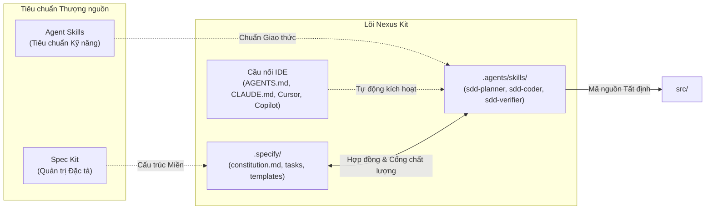

# Nexus Kit

<p align="center">
  <a href="README.md"><b>English</b></a> | <b>Tiếng Việt</b>
</p>

<p align="center">
  <a href="https://www.npmjs.com/package/create-nexus-kit"></a>
  <a href="LICENSE"></a>
  <a href="https://github.com/TranHuuQuyet/nexus-kit/actions"></a>
  <a href="create-nexus-kit/package.json"></a>
</p>

---

## Tổng quan

Nexus Kit là khung điều phối tích hợp giữa **Spec Kit** (quản trị đặc tả) và **Agent Skills** (tiêu chuẩn kỹ năng cho AI Agent). Cấu trúc này thiết lập một môi trường kỹ thuật kỷ luật, tất định, nhằm loại bỏ hoàn toàn tình trạng lập trình theo cảm tính (Vibe Coding) trên tất cả các AI IDE phổ biến.

---

## Điều kiện tiên quyết

Nexus Kit kết nối hai tiêu chuẩn mở thượng nguồn:

1. **[Spec Kit](https://github.com/github/spec-kit)**: Công cụ và tiêu chuẩn quản lý vòng đời đặc tả (Specification Lifecycle).
2. **[Agent Skills](https://github.com/anthropics/agent-skills)**: Tiêu chuẩn công nghiệp mở định nghĩa hành vi và kỹ năng cho AI Agent (`SKILL.md`).

---

## Kiến trúc hệ thống



### Vai trò các thành phần

- **`.specify/` (Miền Spec Kit)**: Chứa bản quy chuẩn kỹ thuật (`constitution.md`), các mẫu đặc tả (`templates/`) và các bản thiết kế tính năng (`tasks/`). Đây là nguồn chân lý duy nhất (Single Source of Truth).
- **`.agents/skills/` (Miền Agent Skills)**: Hiện thực hóa bộ ba kỹ năng SDD chuẩn công nghiệp:
  - **`sdd-planner`**: Phỏng vấn làm rõ yêu cầu, khóa phạm vi (Scope Lock) và khởi tạo đặc tả kỹ thuật chuẩn hóa trong `.specify/tasks/`.
  - **`sdd-coder`**: Lập trình mã nguồn trong `src/` với kiểu dữ liệu chặt chẽ, viết test tự động và bám sát phạm vi bản spec.
  - **`sdd-verifier`**: Thực hiện kiểm toán không khoan nhượng (Zero-Trust Audit), lập bảng truy vết đối chiếu từng tiêu chí nghiệm thu (`AC`).
- **Cầu nối IDE & Cơ chế nạp đã kiểm chứng**: Các tệp cấu hình riêng cho từng công cụ lập trình AI:
  - **Antigravity / Chuẩn mở**: Tự động nạp vô điều kiện tệp `AGENTS.md` (directory-based rule, không chứa frontmatter) và tự động quét kỹ năng tại `.agents/skills/*/SKILL.md`.
  - **Claude Code**: Tự động nạp tệp `CLAUDE.md` ở thư mục gốc.
  - **Cursor**: Tự động áp dụng `.cursor/rules/nexus-kit.mdc` qua cờ `alwaysApply: true`.
  - **GitHub Copilot**: Tự động nạp `.github/copilot-instructions.md`.
- **`src/`**: Mã nguồn sản phẩm, được sinh ra có kiểm soát và truy vết trực tiếp tới spec đã duyệt.

---

## Các IDE được hỗ trợ chính thức

| IDE / Agent | Cơ chế nạp Quy tắc (Rules) | Cơ chế nạp Kỹ năng (Skills) | Trạng thái |
| :--- | :--- | :--- | :--- |
| **Antigravity** | `AGENTS.md` (quy tắc vô điều kiện tại gốc) | `.agents/skills/*/SKILL.md` | Đã kiểm chứng |
| **Claude Code** | `CLAUDE.md` (tại thư mục gốc) | `.agents/skills/*/SKILL.md` | Đã kiểm chứng |
| **Cursor** | `.cursor/rules/nexus-kit.mdc` (`alwaysApply: true`) | `.agents/skills/*/SKILL.md` | Đã kiểm chứng |
| **GitHub Copilot** | `.github/copilot-instructions.md` | `.agents/skills/*/SKILL.md` | Đã kiểm chứng |

---

## Khởi tạo dự án

Khởi tạo một dự án mới an toàn (mặc định tự động **bỏ qua các tệp đã tồn tại** để bảo vệ dữ liệu hiện có):

```bash
# Cách 1: Sử dụng npx (Khuyên dùng)
npx create-nexus-kit@latest my-project

# Tích hợp an toàn vào dự án đang có sẵn (không ghi đè file cũ)
npx create-nexus-kit@latest .

# Chủ động ghi đè lại các tệp nếu muốn thiết lập lại từ đầu
npx create-nexus-kit@latest . --force

# Cách 2: Cài đặt Global (dùng lệnh rút gọn 'nexus-kit')
npm install -g create-nexus-kit
nexus-kit my-project

# Cách 3: Sử dụng Shell Script (không cần cài trước Node.js)
curl -sL https://raw.githubusercontent.com/TranHuuQuyet/nexus-kit/main/create-nexus-kit/install.sh | bash
```

### Các lệnh vận hành hằng ngày

```bash
# Phê duyệt Spec và đóng dấu mã băm SHA-256 (chống sửa đổi lén hoặc spec lỗi thời)
npx create-nexus-kit@latest --approve .specify/tasks/001-feature-spec.md

# Kiểm tra Spec đã được duyệt và còn nguyên vẹn trước khi Coder triển khai
npx create-nexus-kit@latest --verify-spec .specify/tasks/001-feature-spec.md

# Chạy kiểm định toàn vẹn hệ thống (specs, hashes, skills, adapters, template parity)
npx create-nexus-kit@latest --doctor
```
*(Sau khi cài `npm i -g create-nexus-kit`, bạn có thể gõ ngắn gọn `nexus-kit` thay cho `npx create-nexus-kit@latest`.)*

---

## Cấu trúc thư mục

```text
nexus-kit/
├── .specify/                         # Miền Spec Kit
│   ├── constitution.md               # Quy chuẩn kỹ thuật & công nghệ
│   ├── templates/                    # Mẫu đặc tả kỹ thuật
│   │   └── spec-template.md
│   └── tasks/                        # Các bản đặc tả tính năng
├── .agents/skills/                   # Miền Agent Skills
│   ├── sdd-planner/SKILL.md          # Lập kế hoạch kiến trúc & đặc tả
│   ├── sdd-coder/SKILL.md            # Triển khai mã nguồn tất định
│   └── sdd-verifier/SKILL.md         # Kiểm toán đối chiếu tiêu chí spec
├── .cursor/rules/nexus-kit.mdc       # Quy tắc tự động cho Cursor IDE
├── .github/copilot-instructions.md   # Quy tắc tự động cho GitHub Copilot
├── AGENTS.md                         # Quy tắc tự động cho Antigravity / Chuẩn mở
├── CLAUDE.md                         # Quy tắc tự động cho Claude Code
├── src/                              # Mã nguồn ứng dụng
├── create-nexus-kit/                 # Gói công cụ dòng lệnh (npm)
├── .github/workflows/ci.yml          # Đường ống CI tự động
├── CONTRIBUTING.md                   # Hướng dẫn đóng góp
├── README.md                         # Tài liệu tiếng Anh
├── README.vi.md                      # Tài liệu tiếng Việt
└── LICENSE                           # Giấy phép MIT
```

---

## Hướng dẫn sử dụng thực tế (Step-by-Step)

```
Cấu hình Stack ➔ sdd-planner (Lập Spec) ➔ --approve (SHA-256) ➔ sdd-coder (Code) ➔ sdd-verifier (Kiểm toán)
```

1. **Cấu hình Tech Stack (Làm 1 lần đầu)**: Mở `.specify/constitution.md` và cập nhật dòng số 4 (ví dụ: `TypeScript 5, Next.js 15, Zod, Vitest`), sau đó chạy `npx create-nexus-kit@latest --doctor`.
2. **Lập kế hoạch (`sdd-planner`)**: Mở AI IDE và chat với Agent:
   > *"Hãy lập kế hoạch tính năng xác thực JWT. Chưa viết code vội."*  
   Agent sẽ đọc `constitution.md`, hỏi làm rõ yêu cầu và tạo `.specify/tasks/001-jwt-auth-spec.md` (`Status: Draft`).
3. **Con người duyệt & Đóng dấu (`--approve`)**: Kiểm tra bản spec rồi chốt bằng lệnh:
   ```bash
   npx create-nexus-kit@latest --approve .specify/tasks/001-jwt-auth-spec.md
   ```
4. **Triển khai & Kiểm toán (`sdd-coder` + `sdd-verifier`)**: Chat tiếp với Agent:
   > *"Hãy triển khai code cho spec `.specify/tasks/001-jwt-auth-spec.md`."*  
   `sdd-coder` kiểm tra `--verify-spec` (chặn spec `Draft` hoặc đã bị sửa đổi sau duyệt), viết code trong `In-Scope` kèm unit test. `sdd-verifier` đối chiếu các tiêu chí nghiệm thu, tích `[x]`, chuyển `Status: Completed` và chạy `--doctor`.
5. **Quản lý thay đổi (Change Management)**: Nếu cần đổi yêu cầu giữa chừng, yêu cầu `sdd-planner` tăng `Version` (ví dụ `1.0.0` ➔ `1.1.0`), ghi vào `## Change Log`, đưa `Status` về `In Review`, rồi chạy lại `--approve` trước khi cho phép `sdd-coder` sửa code.

---

## Bản quyền & Quản trị

### Giấy phép
Dự án được phân phối theo giấy phép mã nguồn mở [MIT License](LICENSE) © 2026 [Tran Huu Quyet](https://github.com/TranHuuQuyet).

### Ghi nhận nguồn gốc
Nexus Kit là một dự án độc lập, kế thừa và tích hợp các tiêu chuẩn mở:
- **[Spec Kit](https://github.com/github/spec-kit)**: Tư tưởng và quy chuẩn phát triển hướng đặc tả (SDD).
- **[Agent Skills](https://github.com/anthropics/agent-skills)**: Tiêu chuẩn mở về định dạng và môi trường thực thi kỹ năng cho AI Agent.

### Tuyên bố miễn trừ
Phần mềm, các mẫu tài liệu và hướng dẫn agent được cung cấp theo nguyên trạng ("AS IS"), không đi kèm bất kỳ bảo đảm nào. Người dùng chịu trách nhiệm kiểm thử, đánh giá và phê duyệt toàn bộ mã nguồn do AI Agent sinh ra trước khi đưa vào môi trường vận hành thực tế.
