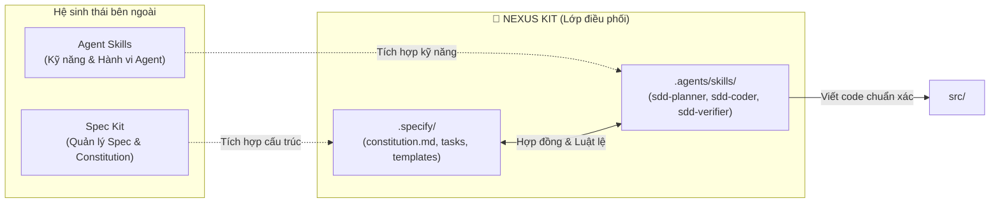

# Nexus Kit 🌌

<p align="center">
  <a href="README.md"><b>English</b></a> | <b>Tiếng Việt</b>
</p>

---

**Khung tích hợp tối ưu giữa Spec Kit & Agent Skills**

Nexus Kit là lớp điều phối và tích hợp tối ưu (Orchestration Layer) kết nối giữa **Spec Kit** (hệ thống quản trị đặc tả) và **Agent Skills** (hệ sinh thái kỹ năng của AI Agent). Cấu trúc này thiết lập một môi trường làm việc kỷ luật, đảm bảo AI Agents luôn vận hành có quy trình, loại bỏ hoàn toàn tình trạng "Vibe Coding".

---

## 🔗 Điều kiện tiên quyết (Prerequisites)

Để phát huy tối đa sức mạnh của Nexus Kit, môi trường phát triển của bạn nên có sẵn:

1. **[Spec Kit](https://github.com/github/spec-kit)**: Công cụ và tiêu chuẩn quản lý vòng đời đặc tả (Specification Lifecycle).
2. **[Agent Skills](https://github.com/anthropics/agent-skills)**: Tiêu chuẩn và kho kỹ năng định hướng hành vi cho AI Agent.

---

## ⚙️ Nexus Kit kết hợp 2 hệ sinh thái như thế nào?



- **`.specify/` (Kế thừa Spec Kit)**: Nơi chứa bộ luật (`constitution.md`), các mẫu đặc tả (`templates/`) và các bản thiết kế tính năng (`tasks/`). Đây là "nguồn chân lý duy nhất" (Source of Truth) cho toàn bộ dự án.
- **`.agents/skills/` (Chuẩn Agent Skills)**: Chứa bộ ba kỹ năng chuyên biệt do Nexus Kit cung cấp để làm cầu nối:
  - **`sdd-planner`**: Dạy AI cách tuân thủ luật trong `constitution.md` và tạo ra các bản task spec chuẩn mực trong `.specify/tasks/`.
  - **`sdd-coder`**: Dạy AI cách đọc spec từ `.specify/tasks/` và phối hợp với các kỹ năng coding khác để hiện thực hóa vào `src/`.
  - **`sdd-verifier`**: Tự động kiểm toán chéo mã nguồn đối chiếu với từng tiêu chí nghiệm thu (Acceptance Criteria) trong spec.
- **`src/`**: Mã nguồn sản phẩm, được sinh ra hoàn toàn tất định và bám sát spec.

---

## 🚀 Khởi tạo nhanh với CLI

Bạn có thể nhanh chóng khởi tạo một dự án mới theo chuẩn Nexus Kit bằng công cụ dòng lệnh:

```bash
# Cách 1: Sử dụng npx (khuyên dùng)
npx create-nexus-kit my-project

# Cách 2: Sử dụng Curl (không cần cài trước Node.js)
curl -sL https://raw.githubusercontent.com/TranHuuQuyet/nexus-kit/main/create-nexus-kit/install.sh | bash
```

---

## 📁 Kiến trúc thư mục

- **`.specify/`**: Nơi chứa bộ luật (`constitution.md`), mẫu đặc tả (`templates/spec-template.md`) và các bản thiết kế tính năng (`tasks/`). Đây là "pháp luật và nguồn chân lý" của dự án.
- **`.agents/skills/`**: Nơi chứa bộ ba kỹ năng SDD định hướng hành vi cho AI:
  - `sdd-planner`: Lập kế hoạch kiến trúc và sinh spec.
  - `sdd-coder`: Lập trình tất định bám sát spec.
  - `sdd-verifier`: Kiểm toán code đối chiếu tiêu chí nghiệm thu.
- **`src/`**: Nơi chứa mã nguồn thực tế của sản phẩm.

---

## 🤖 Quy trình vận hành cho AI Agent

```
Người dùng yêu cầu ➔ sdd-planner lập Spec ➔ Con người duyệt ➔ sdd-coder viết Code ➔ sdd-verifier kiểm toán
```

1. **Lập kế hoạch (Planning)**: Gọi Agent yêu cầu lập kế hoạch tính năng (Agent kích hoạt `sdd-planner`, nạp `spec-template.md`, sinh spec vào `.specify/tasks/`).
2. **Con người phê duyệt (Human Gate)**: Xem xét và duyệt bản spec trước khi cho phép viết code.
3. **Triển khai (Coding)**: Yêu cầu Agent tiến hành code (Agent kích hoạt `sdd-coder`, viết code chuẩn xác vào `src/` kèm test).
4. **Kiểm toán chất lượng (Verification)**: Agent kích hoạt `sdd-verifier` để tự đối chiếu toàn bộ Acceptance Criteria trước khi hoàn tất task.

---

## 📜 Bản quyền, Pháp lý & Tuyên bố miễn trừ

### 1. Giấy phép bản quyền (License)
Dự án được phân phối dưới giấy phép **[MIT License](LICENSE)** © 2026 [Tran Huu Quyet](https://github.com/TranHuuQuyet).  
Bạn hoàn toàn có quyền tự do sử dụng, chỉnh sửa, tích hợp, phân phối lại hoặc thương mại hóa dự án này mà không bị ràng buộc bản quyền thương mại.

### 2. Ghi nhận nguồn gốc & Tiêu chuẩn mở (Attribution & Upstream Paradigms)
Nexus Kit là một dự án mã nguồn mở độc lập, kết hợp và tôn trọng các tiêu chuẩn mở thượng nguồn:
- **[Spec Kit](https://github.com/github/spec-kit)**: Cung cấp tư tưởng và cấu trúc đặc tả hướng quy chuẩn (Specification-Driven Development).
- **[Agent Skills Standard](https://github.com/anthropics/agent-skills)**: Cung cấp tiêu chuẩn định dạng kỹ năng mở cho AI Agents (`SKILL.md`).

### 3. Tuyên bố miễn trừ trách nhiệm (AI Governance Disclaimer)
Phần mềm này cùng các quy tắc và mẫu lệnh AI được cung cấp theo nguyên trạng (**"AS IS"**), không đi kèm bất kỳ sự bảo đảm nào. Người dùng và doanh nghiệp có trách nhiệm rà soát, kiểm thử và phê duyệt mọi dòng mã nguồn do AI Agent sinh ra trước khi đưa vào môi trường vận hành thực tế (Production). Tác giả không chịu trách nhiệm đối với bất kỳ rủi ro, lỗi logic hoặc thiệt hại nào phát sinh từ việc sử dụng mã nguồn do AI sinh ra.
