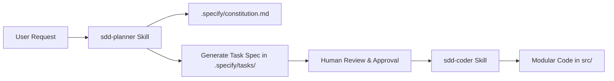

# create-nexus-kit 🌌

[](https://www.npmjs.com/package/create-nexus-kit)
[](https://opensource.org/licenses/MIT)
[](https://nodejs.org)
[](package.json)

> **Scaffold a production-grade Nexus Kit project in seconds.**  
> The intersection of **Spec Kit** (laws & guardrails) and **Agent Skills** (disciplined execution) to eliminate AI "vibe coding".

---

## 💡 Why Nexus Kit?

Large Language Models and AI coding assistants are extraordinarily capable, but when left unchecked, they fall into **"Vibe Coding"**:
- Jumping straight to code without understanding architecture.
- Hallucinating unneeded libraries and patterns.
- Silently bypassing edge cases and types.
- Breaking existing functionality across iterations.

**Nexus Kit** establishes an uncompromising engineering framework:
1. **Constitution First:** Every AI agent must read `.specify/constitution.md` before doing anything.
2. **Spec Before Code:** No code is written until a structured specification is planned in `.specify/tasks/`.
3. **Deterministic Skills:** AI agents operate through explicit skills (`sdd-planner` and `sdd-coder`) to plan, verify, and implement deterministically.

---

## 🚀 Quick Start

### Method 1: Using NPX (Recommended)

No installation required. Run directly with Node.js:

```bash
# Scaffold in a new folder
npx create-nexus-kit my-app

# Or scaffold inside the current directory
npx create-nexus-kit .
```

### Method 2: Using Curl (Zero Node prerequisite for bootstrapping)

```bash
# Default project name (nexus-kit-app)
curl -sL https://raw.githubusercontent.com/TranHuuQuyet/create-nexus-kit/main/install.sh | bash

# Custom project name
curl -sL https://raw.githubusercontent.com/TranHuuQuyet/create-nexus-kit/main/install.sh | bash -s -- my-app
```

### Method 3: Global NPM Install

```bash
npm install -g create-nexus-kit
create-nexus-kit my-app
```

---

## 📁 Generated Project Structure

```text
my-app/
├── .agents/
│   └── skills/
│       ├── sdd-planner/
│       │   └── SKILL.md       # Skill: Generate architecture & task specifications
│       └── sdd-coder/
│           └── SKILL.md       # Skill: Write modular code strictly adhering to specs
├── .specify/
│   ├── constitution.md        # The project's Core Laws (Anti-Vibe-Coding, Types, Quality Gates)
│   ├── tasks/                 # Active and completed feature specifications (.md)
│   └── templates/             # Reusable specification templates
├── src/                       # Production application code
├── .gitignore                 # Pre-configured standard exclusions
└── README.md                  # Project overview & agent instructions
```

---

## 🤖 The SDD Agent Workflow



1. **Plan**: Prompt your AI agent to design a feature. The agent triggers `sdd-planner`, reads `constitution.md`, asks clarifying questions, and writes `.specify/tasks/<feature>-spec.md`.
2. **Approve**: Review the generated specification (Data models, API contracts, Edge cases).
3. **Build**: Prompt the agent to implement the approved spec. The agent activates `sdd-coder` to write exact, type-safe code in `src/`.

---

## 🛠️ Maintainer & Publishing Guide

To publish `create-nexus-kit` to the npm registry:

```bash
# 1. Login to npm (if not already logged in)
npm login

# 2. Test locally
npm test

# 3. Publish to npm
npm publish --access public
```

---

## 📄 License

[MIT](LICENSE) © [Tran Huu Quyet](https://github.com/TranHuuQuyet)
